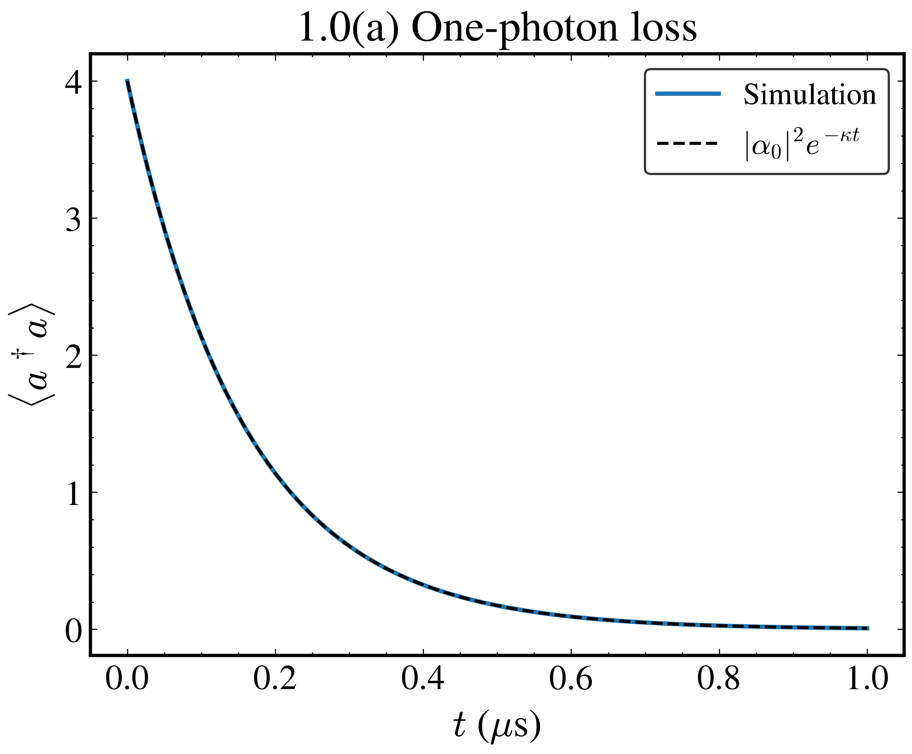
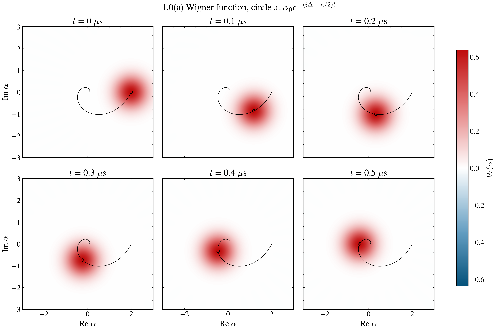
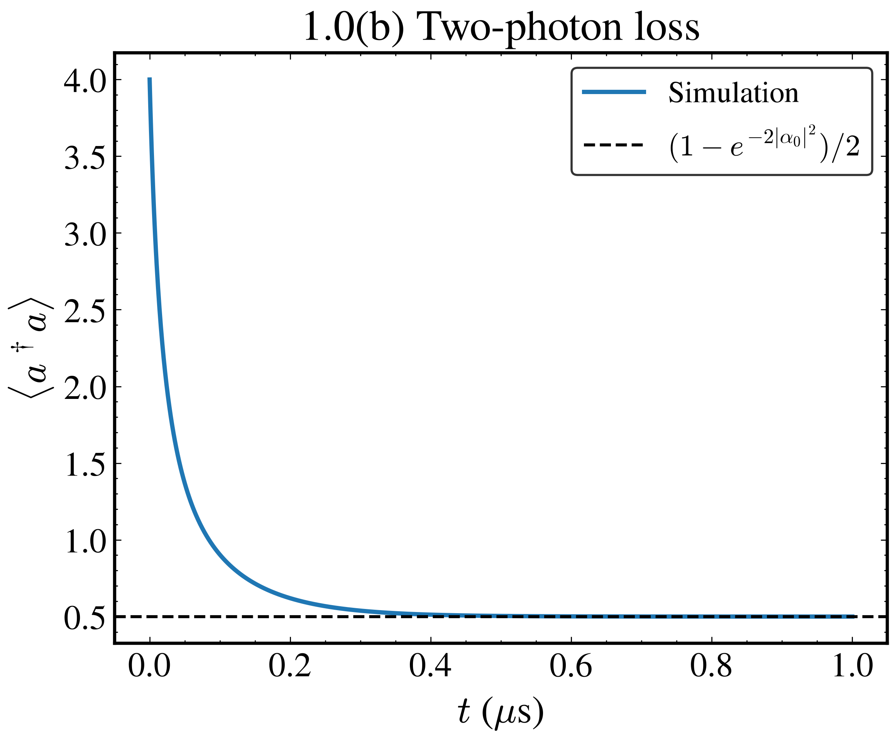
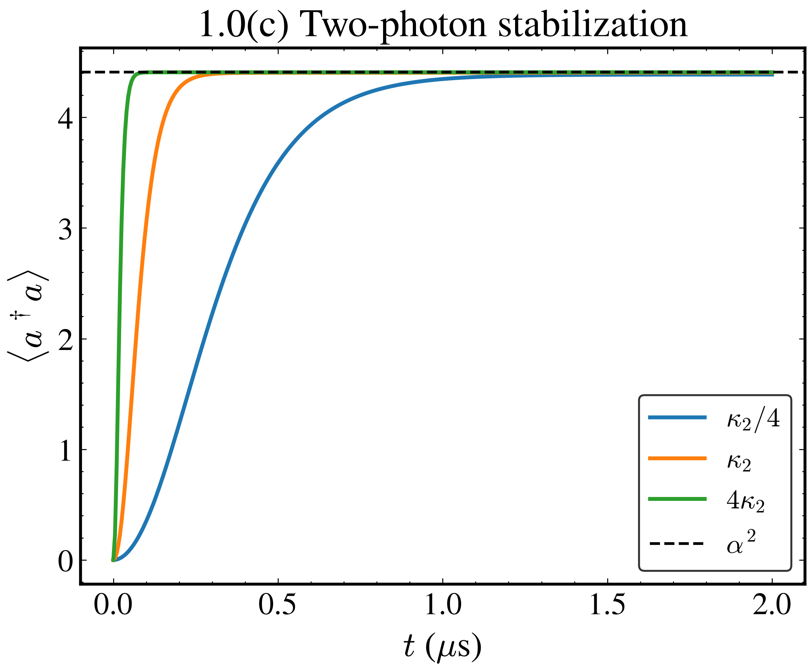
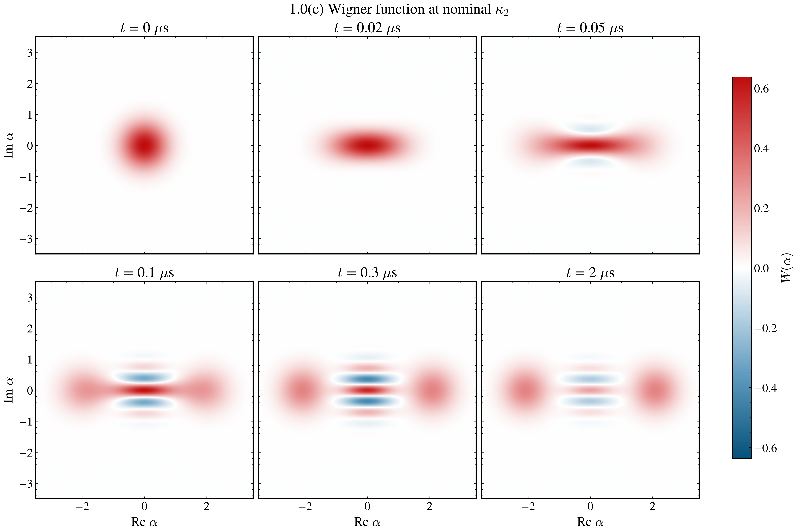

# DuQuantum cat qubit challenge

Simulations for the Alice & Bob cat qubit challenge (`ChallengePrompt.md`), done with `dynamiqs` in double precision. Time is in µs and rates are in rad/µs, with $\omega = 2\pi f$ for every quoted frequency.

Run `uv sync`, then `uv run python scripts/task1_0_warmup.py`. Figures go to `plots/` and raw arrays to `results/task1_0.npz`. Task 1.0 runs in about 20 s on a CPU.

## Task 1.0 warm-up on the memory alone

All three parts use one mode truncated at $N = 30$ Fock states. The two-photon rate is $\kappa_2 = 4g_2^2/\kappa_b = 2\pi \times 0.896$ MHz, from $g_2/2\pi = 0.763$ MHz and $\kappa_b/2\pi = 2.6$ MHz. In the Wigner plots a coherent state $|\alpha\rangle$ sits at $(\mathrm{Re}\,\alpha, \mathrm{Im}\,\alpha)$, and the circles in the 1.0(a) figure, drawn at the analytic center, confirm this convention.

### 1.0(a) One-photon loss

With $H = \Delta a^\dagger a$ and jump operator $\sqrt{\kappa}\,a$, the mean field obeys $d\langle a\rangle/dt = -(i\Delta + \kappa/2)\langle a\rangle$. Because $a|\alpha\rangle = \alpha|\alpha\rangle$, a lost photon leaves a coherent state unchanged, so the state stays coherent and only its amplitude moves,

$$|\alpha_0\rangle \to |\alpha_0 e^{-(i\Delta + \kappa/2)t}\rangle, \qquad \langle a^\dagger a\rangle = |\alpha_0|^2 e^{-\kappa t}.$$

We take $\Delta/2\pi = \kappa/2\pi = 1$ MHz, $\alpha_0 = 2$ and $0 \le t \le 1$ µs. The simulated photon number matches $|\alpha_0|^2 e^{-\kappa t}$ to $1.5 \times 10^{-8}$, and the fidelity with the predicted coherent state is at least 0.999998 at all 201 saved times. The blob turns clockwise once per µs while it shrinks, and it stays round.

### 1.0(b) Two-photon loss

With $H = 0$ and jump operator $\sqrt{\kappa_2}\,a^2$, photons leave only in pairs. The jump $a^2$ and the no-jump term $a^{\dagger 2} a^2$ both keep the photon-number parity, so every even Fock state ends in $|0\rangle$ and every odd one in $|1\rangle$, the two states that $a^2$ annihilates. The final photon number is therefore the odd-parity weight of the initial state,

$$\langle a^\dagger a\rangle_\infty = \frac{1 - e^{-2|\alpha_0|^2}}{2} = 0.499832 \quad (\alpha_0 = 2).$$

Only $5e^{-4} = 9\%$ of $|\alpha_0 = 2\rangle$ starts in $|0\rangle$ and $|1\rangle$, yet the plateau is near 0.5, because the whole odd half of the state ends in $|1\rangle$.

The simulation gives $\langle a^\dagger a\rangle = 0.499847$ at 1 µs, $1.5 \times 10^{-5}$ above the analytic plateau. The slowest step, $|2\rangle \to |0\rangle$, has rate $2\kappa_2 = 11.3\ \mu\mathrm{s}^{-1}$, so the curve is flat well before 1 µs.

### 1.0(c) Two-photon stabilization

The jump operator $\sqrt{\kappa_2}\,(a^2 - \alpha^2)$ removes photon pairs and, through the $-\alpha^2$ term, adds them back. Its dark states are $|\pm\alpha\rangle$, since $a^2|\pm\alpha\rangle = \alpha^2|\pm\alpha\rangle$, so the memory settles in the space they span with $\langle a^\dagger a\rangle \approx \alpha^2 = 4.41$ for $\alpha = 2.1$. This jump operator also keeps parity, so the even vacuum goes to the even cat $(|\alpha\rangle + |-\alpha\rangle)/\mathcal N_+$. The second jump operator $\sqrt{\kappa_a}\,a$, with $\kappa_a/2\pi = 9.3$ kHz, flips the parity at each jump and slowly washes out the fringes.

With $\kappa_a = 0$ the master equation is $\dot\rho = \kappa_2 \mathcal D[a^2 - \alpha^2]\rho$, and in the variable $\kappa_2 t$ the rate drops out, so the settling time scales exactly as $1/\kappa_2$. A nonzero $\kappa_a$ adds a second rate and makes this scaling approximate. A mean-field estimate with both terms gives a steady state $\alpha^2 - \kappa_a/2\kappa_2$, slightly below $\alpha^2$.

We start from vacuum, run $0 \le t \le 2$ µs, and solve $\kappa_2/4$, $\kappa_2$ and $4\kappa_2$ in one batched `mesolve` call.

| Rate | $\langle a^\dagger a\rangle$ at 2 µs | Mean field $\alpha^2 - \kappa_a/2\kappa_2$ | Time to stay within 1% | Rate $\times$ time |
|---|---|---|---|---|
| $\kappa_2/4$ | 4.3872 | 4.3892 | 0.990 µs | 1.393 |
| $\kappa_2$ | 4.4040 | 4.4048 | 0.250 µs | 1.407 |
| $4\kappa_2$ | 4.4081 | 4.4087 | 0.065 µs | 1.463 |

Across a factor of 16 in $\kappa_2$ the product of rate and settling time changes by 5%, so the settling time scales as $1/\kappa_2$. The final photon number sits within 0.002 of the mean-field value at all three rates. In the Wigner snapshots at nominal $\kappa_2$ the vacuum blob stretches along $\mathrm{Re}\,\alpha$, splits into two blobs at $\pm 2.1$ with negative fringes between them by 0.1 µs, and the fringes have visibly faded by 2 µs.

## AI use

Claude Code (Anthropic) wrote `scripts/task1_0_warmup.py` and this README section. Every number here is printed by that script or computed from the stated parameters, and each simulated number is checked against the analytic result beside it.
