# DuQuantum cat qubit challenge

Simulations for the Alice & Bob cat qubit challenge (`ChallengePrompt.md`), done with `dynamiqs` in double precision. Time is in µs and rates are in rad/µs, with $\omega = 2\pi f$ for every quoted frequency.

Run `uv sync`, then each task script from the repository root, for example `uv run python scripts/task1_0_warmup.py`. Figures go to `plots/` and raw arrays to `results/`. Task 1.0 runs in about 20 s and Task 1.1 in about 50 s on a CPU. Task 1.2 solves 11 two-mode models and took 29 min on one CPU core as a Slurm job (`slurm/task1_2.sh`); finished points are cached in `results/task1_2/`. The heavier runs of Tasks 1.3 to 2.4 are Slurm jobs too (`slurm/task*.sh`, mostly arrays of one point per task), and each script caches finished points under `results/` and redoes only the analysis and plots when rerun. Shared parameters and plot helpers are in `scripts/common.py`. Every solve uses the adaptive Tsit5 integrator with relative and absolute tolerance $10^{-10}$, because the default $10^{-6}$ left about $10^{-4}$ of noise in small populations.

## Task 1.0: Warm-up — adding dissipation one ingredient at a time

All three parts use one mode truncated at $N = 30$ Fock states. The two-photon rate is $\kappa_2 = 4g_2^2/\kappa_b = 2\pi \times 0.896$ MHz, from $g_2/2\pi = 0.763$ MHz and $\kappa_b/2\pi = 2.6$ MHz. In the Wigner plots a coherent state $|\alpha\rangle$ sits at $(\mathrm{Re}\,\alpha, \mathrm{Im}\,\alpha)$, and the circles in the 1.0(a) figure, drawn at the analytic center, confirm this convention.

### (a) Single-photon loss, in physical units

With $H = \Delta a^\dagger a$ and jump operator $\sqrt{\kappa}\,a$, the mean field obeys $d\langle a\rangle/dt = -(i\Delta + \kappa/2)\langle a\rangle$. Because $a|\alpha\rangle = \alpha|\alpha\rangle$, a lost photon leaves a coherent state unchanged, so the state stays coherent and only its amplitude moves,

$$|\alpha_0\rangle \to |\alpha_0 e^{-(i\Delta + \kappa/2)t}\rangle, \qquad \langle a^\dagger a\rangle = |\alpha_0|^2 e^{-\kappa t}.$$

We take $\Delta/2\pi = \kappa/2\pi = 1$ MHz, $\alpha_0 = 2$ and $0 \le t \le 1$ µs. The simulated photon number matches $|\alpha_0|^2 e^{-\kappa t}$ to $6 \times 10^{-12}$, and the fidelity with the predicted coherent state rounds to 1.00000000 at all 201 saved times. The blob turns clockwise once per µs while it shrinks, and it stays round.

### (b) Pure two-photon loss

With $H = 0$ and jump operator $\sqrt{\kappa_2}\,a^2$, photons leave only in pairs. The jump $a^2$ and the no-jump term $a^{\dagger 2} a^2$ both keep the photon-number parity, so every even Fock state ends in $|0\rangle$ and every odd one in $|1\rangle$, the two states that $a^2$ annihilates. The final photon number is therefore the odd-parity weight of the initial state,

$$\langle a^\dagger a\rangle_\infty = \frac{1 - e^{-2|\alpha_0|^2}}{2} = 0.499832 \quad (\alpha_0 = 2).$$

Only $5e^{-4} = 9\%$ of $|\alpha_0 = 2\rangle$ starts in $|0\rangle$ and $|1\rangle$, yet the plateau is near 0.5, because the whole odd half of the state ends in $|1\rangle$.

The simulation gives $\langle a^\dagger a\rangle = 0.499847$ at 1 µs, $1.5 \times 10^{-5}$ above the analytic plateau. The slowest step, $|2\rangle \to |0\rangle$, has rate $2\kappa_2 = 11.3\ \mu\mathrm{s}^{-1}$, so the curve is flat well before 1 µs.

### (c) Stabilization: two-photon loss + two-photon drive

The jump operator $\sqrt{\kappa_2}\,(a^2 - \alpha^2)$ removes photon pairs and, through the $-\alpha^2$ term, adds them back. Its dark states are $|\pm\alpha\rangle$, since $a^2|\pm\alpha\rangle = \alpha^2|\pm\alpha\rangle$, so the memory settles in the space they span with $\langle a^\dagger a\rangle \approx \alpha^2 = 4.41$ for $\alpha = 2.1$. This jump operator also keeps parity, so the even vacuum goes to the even cat $(|\alpha\rangle + |-\alpha\rangle)/\mathcal N_+$. The second jump operator $\sqrt{\kappa_a}\,a$, with $\kappa_a/2\pi = 9.3$ kHz, flips the parity at each jump and slowly washes out the fringes.

With $\kappa_a = 0$ the master equation is $\dot\rho = \kappa_2 \mathcal D[a^2 - \alpha^2]\rho$, and in the variable $\kappa_2 t$ the rate drops out, so the settling time scales exactly as $1/\kappa_2$. A nonzero $\kappa_a$ adds a second rate and makes this scaling approximate. A mean-field estimate with both terms gives a steady state $\alpha^2 - \kappa_a/2\kappa_2$, slightly below $\alpha^2$.

We start from vacuum, run $0 \le t \le 2$ µs, and solve $\kappa_2/4$, $\kappa_2$ and $4\kappa_2$ in one batched `mesolve` call.

| Rate | $\langle a^\dagger a\rangle$ at 2 µs | Mean field $\alpha^2 - \kappa_a/2\kappa_2$ | Time to stay within 1% | Rate $\times$ time |
|---|---|---|---|---|
| $\kappa_2/4$ | 4.3872 | 4.3892 | 0.990 µs | 1.393 |
| $\kappa_2$ | 4.4040 | 4.4048 | 0.250 µs | 1.407 |
| $4\kappa_2$ | 4.4081 | 4.4087 | 0.065 µs | 1.463 |

Across a factor of 16 in $\kappa_2$ the product of rate and settling time changes by 5%, so the settling time scales as $1/\kappa_2$. The final photon number sits within 0.002 of the mean-field value at all three rates. In the Wigner snapshots at nominal $\kappa_2$ the vacuum blob stretches along $\mathrm{Re}\,\alpha$, splits into two blobs at $\pm 2.1$ with negative fringes between them by 0.1 µs, and the fringes have visibly faded by 2 µs.

## Task 1.1: The full two-mode model — inflating a cat

The full model keeps the buffer mode $b$ next to the memory,

$$H = g_2\left(a^2 b^\dagger + a^{\dagger 2} b\right) - \epsilon_d\left(b + b^\dagger\right), \qquad \epsilon_d = \alpha^2 g_2,$$

with jump operators $\sqrt{\kappa_b}\,b$ and $\sqrt{\kappa_a}\,a$ and vacuum in both modes at $t = 0$. We use $N_a = 32$ and $N_b = 12$, the smallest truncation that converges the overshoot peak to 0.1% in Task 1.2, and run to 3 µs.

The memory photon number overshoots to 6.908 at 0.235 µs, rings, and stays within 1% of $\alpha^2$ after 1.07 µs, so a 2 µs window covers the transient. At 3 µs it is 4.4026. The buffer peaks at 1.992 photons at 0.135 µs and then empties ($1.8 \times 10^{-5}$ photons at 3 µs). In the truncation check the top two memory levels never hold more than $1.4 \times 10^{-5}$ of the population and the top buffer level $1.7 \times 10^{-4}$ (at 0.22 µs). The values near $10^{-7}$ at late times are solver noise, since a 4.4-photon cat puts less than $10^{-14}$ in level 30.

The memory Wigner function, with the buffer traced out, stretches along $\mathrm{Re}\,\alpha$, splits into two blobs at $\pm 2.1$ with negative fringes between them by 0.2 µs, and the fringes are visibly weaker at 3 µs.

The memory-only model of Task 1.0(c) rises smoothly to 4.4042 with no overshoot. That model assumes the buffer empties much faster than everything else, $\kappa_b \gg g_2, \epsilon_d$, but here $g_2/\kappa_b = 0.29$ and $\epsilon_d/\kappa_b = 1.29$. Linearizing the two-mode mean-field equations about the steady state, $a = \alpha + \delta a$ and $b = \delta b$, gives a damped oscillator,

$$\ddot{\delta a} + \frac{\kappa_b}{2}\,\dot{\delta a} + 4 g_2^2 \alpha^2\, \delta a = 0 .$$

Memory and buffer trade photons at $2 g_2 \alpha = 20.1\ \mu\mathrm{s}^{-1}$, faster than the buffer damps the exchange ($\kappa_b/4 = 4.1\ \mu\mathrm{s}^{-1}$), so the memory overshoots and rings with period $2\pi/\sqrt{(2g_2\alpha)^2 - (\kappa_b/4)^2} = 0.319$ µs. The simulated maxima are 0.320, 0.315, 0.315 and 0.310 µs apart. The memory-only model is the overdamped limit $\kappa_b \gg 8 g_2 \alpha$, and here $\kappa_b/8g_2\alpha = 0.20$.

## Task 1.2: Semiclassical sanity check and convergence study

The converged $\langle a^\dagger a\rangle$ at 3 µs is 4.4026, 0.17% below the semiclassical $\alpha^2 = \epsilon_d/g_2 = 4.41$, and the 10 µs run of Task 1.3 settles at 4.4029 from 6 µs on. The difference is physical: it changes by less than $10^{-5}$ (relative) for every $N_a \ge 20$ and every $N_b$ we tried, and single-photon loss is expected to pull the cat in slightly, to $\alpha^2 - \kappa_a/2\kappa_2 = 4.4048$ in the memory-only mean field.

We vary $N_a$ at $N_b = 16$ and $N_b$ at $N_a = 40$ and track two quantities, the steady state at 3 µs and the overshoot peak. A quantity counts as converged at the smallest $N$ from which every larger $N$ agrees with the largest one to $10^{-3}$.

| $N_a$ ($N_b = 16$) | 16 | 20 | 24 | 32 | 40 |
|---|---|---|---|---|---|
| Overshoot peak | 6.3640 | 6.8026 | 6.8960 | 6.9110 | 6.9111 |
| $\langle a^\dagger a\rangle$ at 3 µs | 4.4061 | 4.4027 | 4.4026 | 4.4026 | 4.4026 |

| $N_b$ ($N_a = 40$) | 4 | 6 | 8 | 10 | 12 | 14 | 16 |
|---|---|---|---|---|---|---|---|
| Overshoot peak | 4.4620 | 6.1143 | 6.7442 | 6.8865 | 6.9084 | 6.9109 | 6.9111 |
| $\langle a^\dagger a\rangle$ at 3 µs | 4.4026 | 4.4026 | 4.4026 | 4.4026 | 4.4026 | 4.4026 | 4.4026 |

The steady state converges from $N_a = 16$ and $N_b = 4$, the overshoot peak only from $N_a = 32$ and $N_b = 12$. The two are not equally sensitive. In the steady state the buffer is empty and the memory holds a 4.4-photon cat, so few levels suffice. During the overshoot the buffer briefly holds about 2 photons and the memory 6.9, and both photon-number distributions reach much higher; at $N_b = 6$ the top buffer level holds 4.6% of the population at 0.14 µs. The buffer truncation matters most: the suggested $N_b = 6$ puts the peak 11.5% too low (6.1143 against 6.9111), while the suggested $N_a = 24$ is 0.22% low.

## Task 1.3 — Open-ended: preparing a logical state

### (a) The even cat and how long it stays one

The memory parity $P = e^{i\pi a^\dagger a}$ commutes with $H_{2\mathrm{ph}}$, whose pair terms change $n_a$ by two while the drive and the buffer loss act on the buffer. With $\kappa_a = 0$ the even vacuum therefore ends in the only even code state, $|\mathcal C_+\rangle$. Memory loss flips the parity, $d\langle P\rangle/dt = -2\kappa_a\langle a^\dagger a\,P\rangle$, and no coherence between even and odd states ever forms, so in the code space

$$\rho_a = \langle P\rangle\,|\mathcal C_+\rangle\langle\mathcal C_+| + \left(1 - \langle P\rangle\right)\tfrac12\left(|\mathcal C_+\rangle\langle\mathcal C_+| + |\mathcal C_-\rangle\langle\mathcal C_-|\right),$$

a superposition of weight $\langle P\rangle$ plus, up to $O(e^{-2\alpha^2})$, the equal mixture of $|\pm\alpha\rangle$. Its purity is $(1 + \langle P\rangle^2)/2$, its fidelity with $|\mathcal C_+\rangle$ is $(1 + \langle P\rangle)/2$ and its coherence is $\langle\alpha|\rho_a|{-\alpha}\rangle = (\langle P\rangle + e^{-2\alpha^2})/2$. The mixture has $\langle P\rangle$ and coherence $1.48 \times 10^{-4}$, purity 0.500000 and fidelity 0.500074.

We run the two-mode model at $\alpha = 2.1$ from vacuum to 10 µs at $N_a = 32$, $N_b = 12$ (2001 saved times) and with $\kappa_a = 0$ to 3 µs. The top two memory levels hold at most $1.4 \times 10^{-5}$ and the top buffer level $1.7 \times 10^{-4}$, and 40 × 16 reruns change all quantities by at most $1.2 \times 10^{-3}$ before 2 µs and $3.1 \times 10^{-6}$ after, so the table has three digits.

| $t$ (µs) | $\langle P\rangle$ | Fidelity with $\vert\mathcal C_+\rangle$ | Purity | $(1 + \langle P\rangle^2)/2$ | $\langle\alpha\vert\rho_a\vert{-\alpha}\rangle$ |
|---|---|---|---|---|---|
| 0.5 | 0.816 | 0.825 | 0.708 | 0.833 | 0.370 |
| 1 | 0.629 | 0.811 | 0.692 | 0.698 | 0.313 |
| 2 | 0.376 | 0.688 | 0.571 | 0.571 | 0.188 |
| 4 | 0.135 | 0.567 | 0.509 | 0.509 | 0.067 |

After 2 µs (n = 1601) the purity, the summed fidelities with $|\mathcal C_\pm\rangle$ and the coherence follow the formulas to $1.5 \times 10^{-5}$, and $W(0) = (2/\pi)\langle P\rangle$ to four digits at all eight snapshots, so the state is a superposition whose fringes fade with $\langle P\rangle$. With $\kappa_a = 0$, $\langle P\rangle = 1$ to $3.6 \times 10^{-15}$ and the fidelity with $|\mathcal C_+\rangle$ reaches 0.996 at 1 µs and $1 - 1.2 \times 10^{-8}$ at 3 µs, where $\langle a^\dagger a\rangle = 4.4087 = \alpha^2\tanh\alpha^2$. With $\kappa_a$ it peaks at 0.844.

The purity dips even at $\kappa_a = 0$, to 0.654 at 0.295 µs (40 × 16), after the buffer peak at 0.135 µs. The joint memory and buffer purity there is 0.504 and their Rényi-2 mutual information only 0.068, so the memory is mostly correlated with the field emitted through the buffer, which records the converted pairs. That record tells nothing apart once the buffer has emptied, since the even code space holds only $|\mathcal C_+\rangle$, and the purity exceeds 0.99 from 0.975 µs.

A fit $\langle P\rangle = A e^{-\Gamma t} + C$ on 2 to 10 µs (n = 1601, largest residual $5.9 \times 10^{-7}$) gives $1/\Gamma = 1.9434$ µs. That matches $1/(2\kappa_a\bar n) = 1.9435$ µs for the mean 4.4028 photons in the window and is 0.16% longer than $1/(2\kappa_a\alpha^2) = 1.9403$ µs. The floor $C = 3.167 \times 10^{-4}$, the same to four digits at 40 × 16 and for windows from 3 or 4 µs, is the steady parity of the model, 7% above the ideal-cat value $1/\cosh(2\alpha^2) = 2.955 \times 10^{-4}$ set by the odd cat losing photons faster. Fixing $C$ there changes $\Gamma$ by $2.0 \times 10^{-4}$ (relative).

We call the state a superposition while $\langle P\rangle > 1/2$, when the $|\mathcal C_+\rangle$ term outweighs the mixture. That holds until 1.450 µs (1.446 µs from the fit), and inflation alone lasts until 0.975 µs.

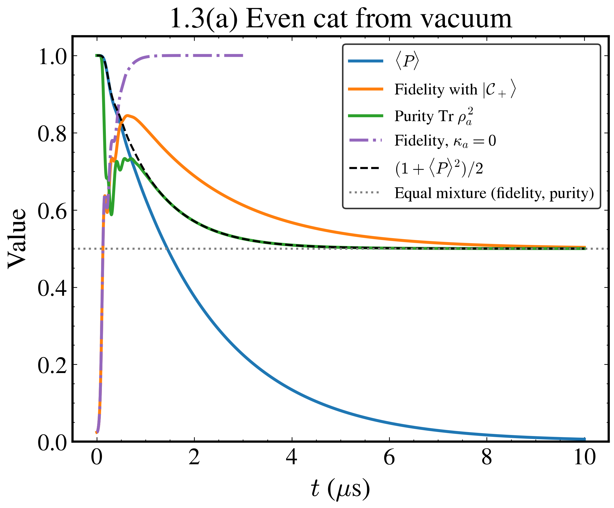

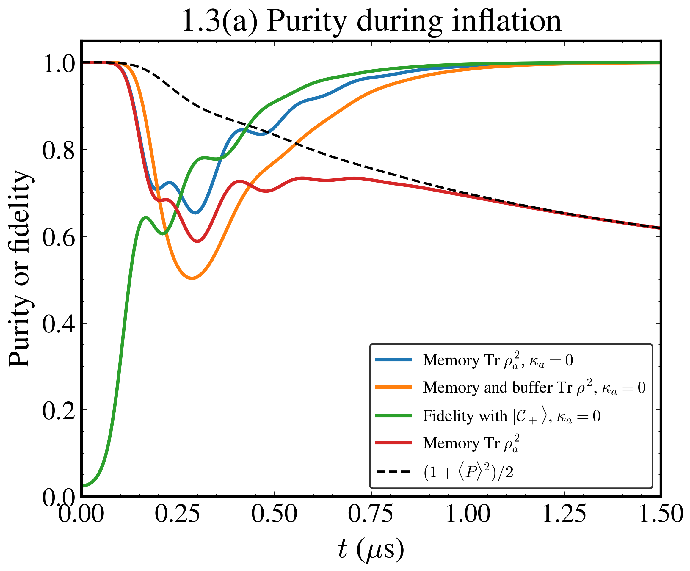

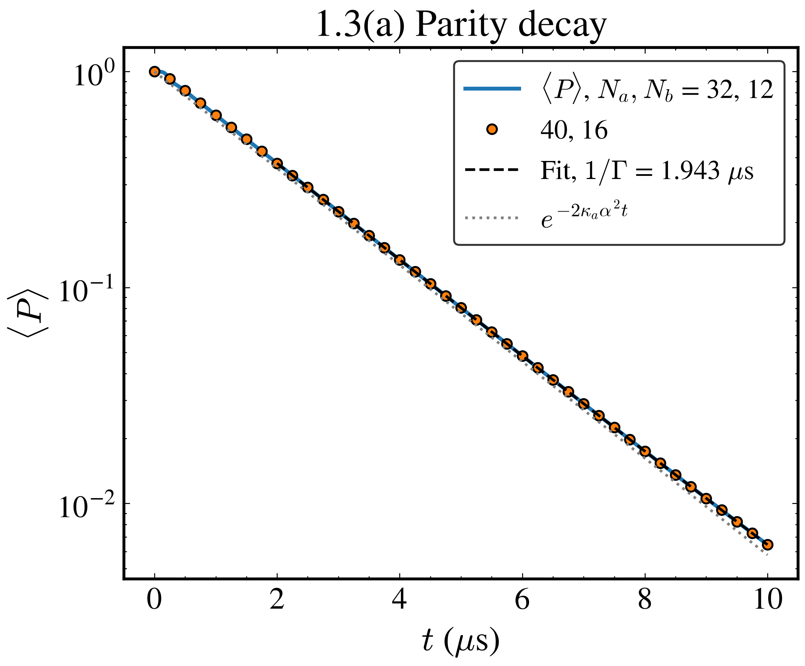

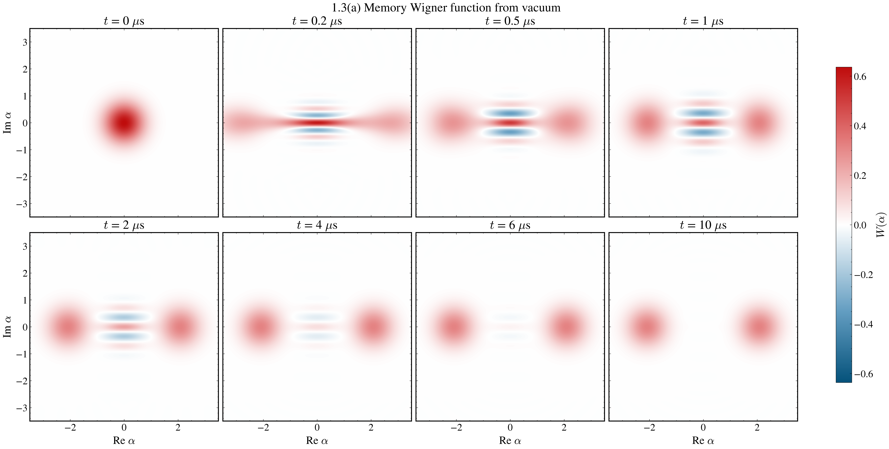

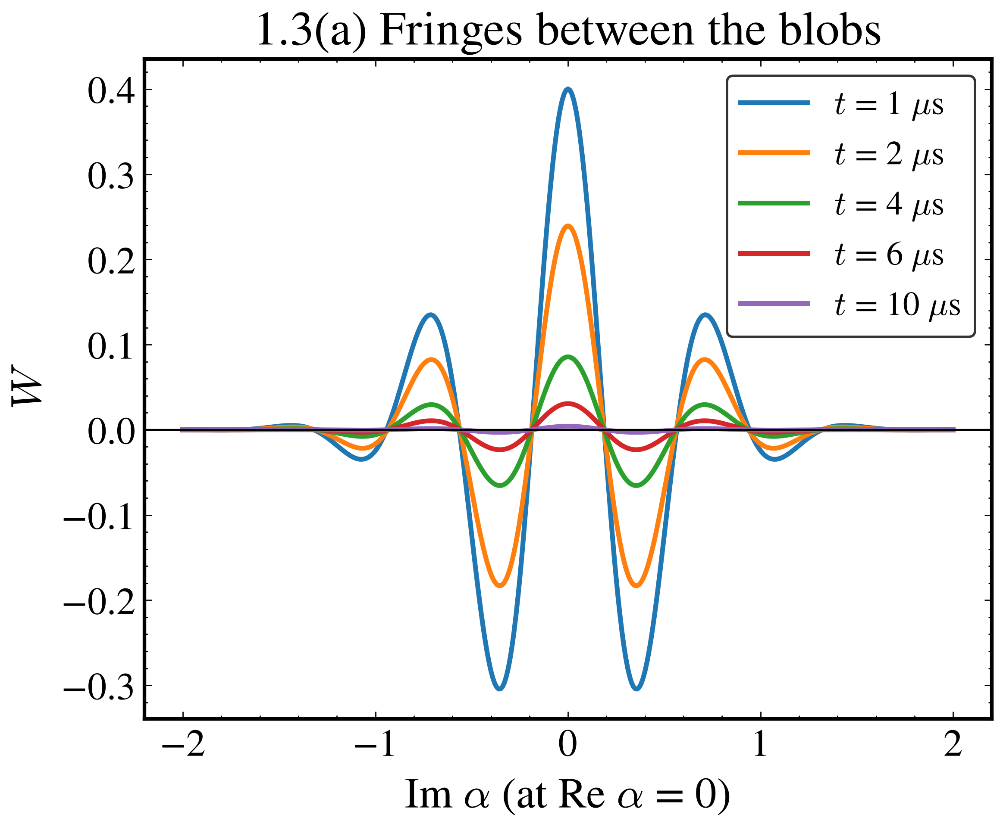

### (b) Preparing $|0_L\rangle = |{+\alpha}\rangle$

We break the $\alpha \to -\alpha$ symmetry during inflation with a memory drive along the real axis, switched on with the pump at $t = 0$,

$$H_x(t) = i\,\epsilon(t)\left(a^\dagger - a\right), \qquad \epsilon(t) = \epsilon_0\sin^2(\pi t/T_{\mathrm{on}}) \ \text{ for } 0 \le t \le T_{\mathrm{on}}.$$

It gives $d\langle a\rangle/dt = \epsilon$, a push along $+\mathrm{Re}\,\alpha$ ($\epsilon(a + a^\dagger)$ would push along $\mathrm{Im}\,\alpha$). Near $a = 0$ the effective model gives $\dot a \approx \kappa_2\alpha^2 a^*$, which stretches $x = \mathrm{Re}\,\alpha$, so each part of the initial state flows to the well on its side of $x = 0$, and a memory starting in $|\beta\rangle$, with $x$ Gaussian of variance 1/4, should end with

$$p(x<0) = \tfrac12\,\mathrm{erfc}\left(\sqrt2\,\beta\right)$$

in the $-\alpha$ well. We compute $p(x<0)$ from the Fock matrix of $\Theta(-x)$ and quote $F = \langle\alpha|\rho_a|\alpha\rangle$ and $\mathrm{Re}\langle a\rangle/\alpha$ at 3 µs (32 × 12). In all 34 runs $1 - F = p(x<0)$ to $1.5 \times 10^{-5}$, and $p(x<0)$ moves by at most $2.8 \times 10^{-5}$ after 1 µs. Started in $|\beta\rangle$ by a displacement before the pump, the memory ends with 0.831 to 0.995 times $\mathrm{erfc}(\sqrt2\beta)/2$ for seven values of $\beta$ from 0.25 to 1.885. Starting in $|\alpha\rangle$ gives the ceiling of the model, $1 - F = 8.6 \times 10^{-6}$, of which the shrink of the cat to $\sqrt{4.4029} = 2.09832$ accounts for $3 \times 10^{-6}$.

| $\epsilon_0/2\pi$ (MHz) | $T_{\mathrm{on}}$ (µs) | $1 - F$ | $\mathrm{Re}\langle a\rangle/\alpha$ |
|---|---|---|---|
| 8 | 0.05 | $8.83 \times 10^{-3}$ | 0.9816 |
| 12 | 0.05 | $3.84 \times 10^{-4}$ | 0.9984 |
| 16 | 0.05 | $1.26 \times 10^{-3}$ | 0.9967 |
| 12 (40 × 16) | 0.1 | 0.0656 | 0.8681 |

Of six 40 × 16 reruns, four change $F$ by at most $3.4 \times 10^{-6}$ and two long strong pulses (top memory levels up to $1.6 \times 10^{-3}$ at 32 × 12) change it by $5.4 \times 10^{-4}$ and $1.8 \times 10^{-3}$, so the last row is at 40 × 16.

The best setting of the sweep, 12 MHz for 0.05 µs, gives $F = 0.99962$ and $\mathrm{Re}\langle a\rangle/\alpha = 0.99845$ (on-times below 0.05 µs were not tried). Its wrong-well weight of $3.9 \times 10^{-4}$ equals $\mathrm{erfc}(\sqrt2\beta)/2$ at $\beta = 1.680$, and the simulated starts match it at $\beta = 1.65$, interpolated between 1.5 ($1 - F = 1.22 \times 10^{-3}$) and 1.885, the pulse's own area ($6.16 \times 10^{-5}$). Displacing before the pump is therefore the better variant in this model, and $\beta = \alpha$ reaches $F = 0.999991$.

The same area over 0.1 µs (6 MHz) gives $1 - F = 2.66 \times 10^{-3}$, half of it ($1.33 \times 10^{-3}$) present when the pulse ends. Stronger pulses overshoot further ($1.329\alpha$ at 16 MHz against $1.168\alpha$ at the best setting), and at 16 MHz the wrong-well weight grows from $2.09 \times 10^{-6}$ at 0.15 µs to $1.16 \times 10^{-3}$ at 0.3 µs, around the backswing minimum of $\mathrm{Re}\langle a\rangle$ at 0.215 µs.

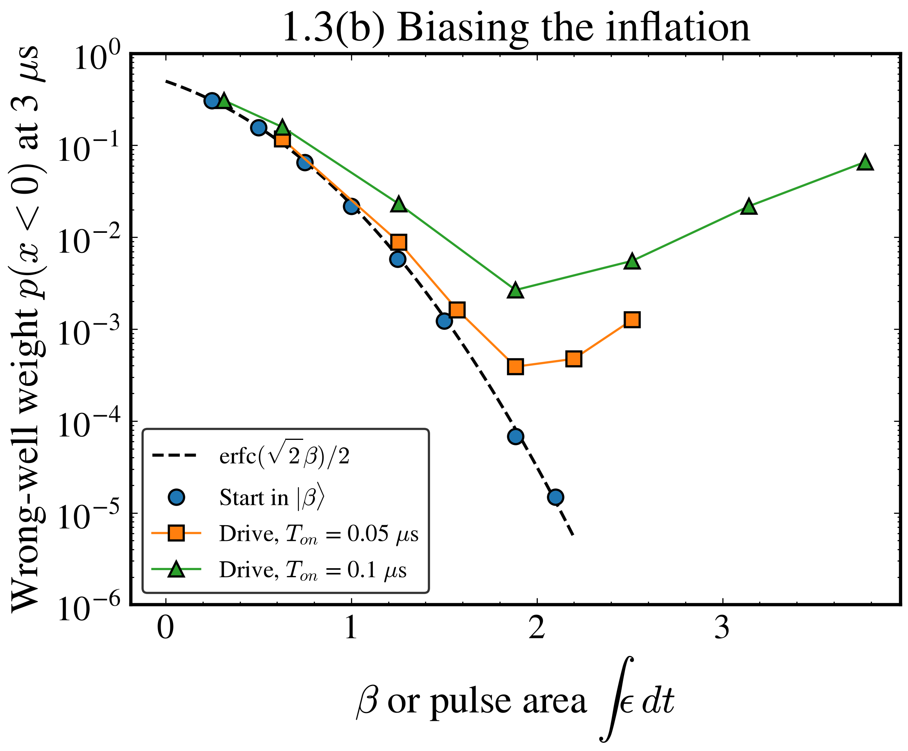

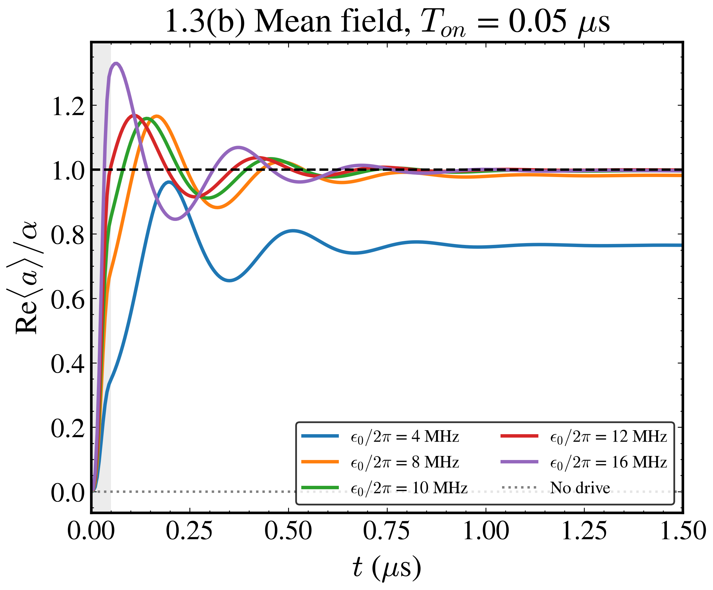

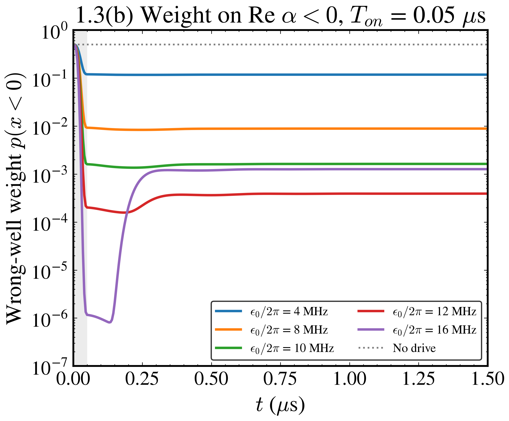

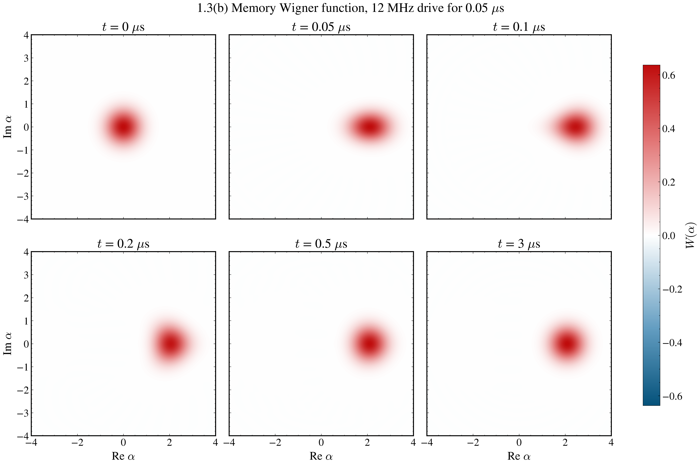

### (c) What the method costs

Both variants need a resonant memory drive, the port of the Task 2.3 readout drive in the other quadrature, so they add a strong pulse (12 MHz peak for about 50 ns) but no hardware, and its phase must be locked to the pump phase that sets the cat axis. An error $\theta$ adds $-\epsilon\sin\theta\,(a + a^\dagger)$, which acts as $-2\alpha\epsilon\sin\theta\,Z$ on the code space. For the in-pump pulse at the best setting, 10° and 30° raise $1 - F$ from $3.8 \times 10^{-4}$ to $5.9 \times 10^{-4}$ and $3.5 \times 10^{-3}$, and at 90° the drive biases nothing ($F = 0.50000$ for 8 MHz over 0.1 µs). Amplitudes of 10 and 14 MHz give $1 - F = 1.6 \times 10^{-3}$ and $4.7 \times 10^{-4}$, and the same area over twice the duration gives 6.92 times the error.

Held on after the cat forms, the drive would tilt the wells and, above $\epsilon_c = 2\kappa_2\alpha^3/(3\sqrt3) = 2\pi \times 3.193$ MHz in the static mean field, remove the $-\alpha$ well. The short in-pump pulse instead costs ringing, which grows with the pulse (12 MHz over 0.1 µs reaches 16.0 photons and keeps the code-space population below 0.99 until 0.875 µs), but no time, since with the best setting that population stays above 0.99 from 0.425 µs, against 0.865 µs undriven. The displacement needs the pump and the buffer drive off while it acts, 0.0557 µs to reach $\beta = \alpha$ with the same 12 MHz $\sin^2$ envelope, after which the memory is already in the code space.

## Task 2.1: Extracting the bit-flip rate $\Gamma_X$

We start in $|\alpha\rangle|0\rangle$ with $\epsilon_d = \alpha^2 g_2$ for each $\alpha$. Both $|\pm\alpha\rangle|0\rangle$ are exact dark states of $H_{2\mathrm{ph}}$ and of the buffer loss, so only $\kappa_a$ moves the state, and a bit flip shows up as a slow decay of $\mathrm{Re}\langle a\rangle$. The model is unchanged under $a \to -a$, so the Lindbladian $\mathcal L$ never mixes the elements $\rho_{(n_a n_b),(m_a m_b)}$ with $n_a - m_a$ odd into those with $n_a - m_a$ even. $\langle a\rangle$ sees only the odd sector, and after a short transient

$$\mathrm{Re}\langle a\rangle(t) = A\,e^{-\Gamma_X t}, \qquad \Gamma_X = -\lambda_1,$$

where $\lambda_1$ is the eigenvalue of $\mathcal L$ in the odd sector closest to zero. We get $\Gamma_X$ in two independent ways: a log-linear fit of $\mathrm{Re}\langle a\rangle(t)$ from `mesolve`, and $\lambda_1$ from sparse shift-invert (`scipy.sparse.linalg.eigs` at $\sigma = 0$) on the odd block of $\mathcal L$. Our sparse $\mathcal L$ matches `dq.slindbladian` to $7 \times 10^{-15}$ at $N_a = 6$, $N_b = 3$.

A bit flip is a rare event, so $\Gamma_X$ needs more levels than the photon number does. For each $\alpha$ we computed $\lambda_1$ for $N_a$ up to 28 at $N_b = 10$ and $N_b$ up to 10 at $N_a = 28$ (from $\alpha = 1.8$, $N_a$ up to 32 and $N_b$ up to 12) and use the cheapest truncation within $10^{-3}$ of the largest. The buffer adds to the cost: $N_b = 3$ is enough at $\alpha = 1.0$, but $\alpha = 1.4$ needs $N_b = 5$ and $\alpha = 2.1$ needs $N_b = 12$. When the memory amplitude passes through zero, the buffer is driven to $|\langle b\rangle|^2 = (2\epsilon_d/\kappa_b)^2$, which is 1.32 photons at $\alpha = 1.4$ and 6.70 at $\alpha = 2.1$, so this growth is consistent with a flip path through $a \approx 0$.

The time-domain runs use $\alpha = 0.8, 1.0, 1.2, 1.4$ and run to $T \ge 2.04\,T_X$, saved at 1251 times (250 in the first 50 µs, 1001 after). The fit window is $[10/\lambda_2, T]$, where $\lambda_2$ is the next odd-sector eigenvalue.

| $\alpha$ | $N_a$, $N_b$ | $T$ (µs) | Window (µs) | $n$ | $\Gamma_X$ fit (µs$^{-1}$) | $-\lambda_1$ (µs$^{-1}$) | $T_X$ (µs) |
|---|---|---|---|---|---|---|---|
| 0.8 | 10, 3 | 500 | 124.1 to 500 | 836 | $6.423008 \times 10^{-3}$ | $6.423008 \times 10^{-3}$ | 155.7 |
| 1.0 | 12, 3 | 1000 | 84.5 to 1000 | 964 | $2.302170 \times 10^{-3}$ | $2.302170 \times 10^{-3}$ | 434.4 |
| 1.2 | 14, 4 | 3500 | 59.5 to 3500 | 998 | $5.998146 \times 10^{-4}$ | $5.998146 \times 10^{-4}$ | 1667.2 |
| 1.4 | 16, 5 | 17000 | 43.8 to 17000 | 1031 | $1.202763 \times 10^{-4}$ | $1.202763 \times 10^{-4}$ | 8314.2 |

The fit and the eigenvalue agree to $1.1 \times 10^{-11}$ (relative) at every $\alpha$. The local rate $-d\ln\mathrm{Re}\langle a\rangle/dt$ settles on $-\lambda_1$ within a few µs, so the transient is the fast confinement; the slower second mode, $\lambda_2 = 0.0806$ to $0.2283\ \mu\mathrm{s}^{-1}$, is never excited: $H$ and the jumps are real in the Fock basis and $\rho(0)$ is real and symmetric, so $\rho(t)$ stays symmetric, while the $\lambda_2$ mode, $|\mathcal C_+\rangle\langle\mathcal C_-| - |\mathcal C_-\rangle\langle\mathcal C_+|$, is antisymmetric. The window start $10/\lambda_2$ is therefore conservative. Moving it by a factor of 2 either way, or ending the window at $T/2$, changes $\Gamma_X$ by at most $1.7 \times 10^{-14}$ (relative). At all saved times the top two memory levels hold at most $4.6 \times 10^{-7}$ and the top buffer level $8.4 \times 10^{-7}$, and a rerun at $(N_a + 4, N_b + 2)$ over $T/2$ moves the fitted $\Gamma_X$ by at most $6.6 \times 10^{-4}$ (relative). The seven-digit values in the table are at the listed truncation, so they carry this $6.6 \times 10^{-4}$ uncertainty.

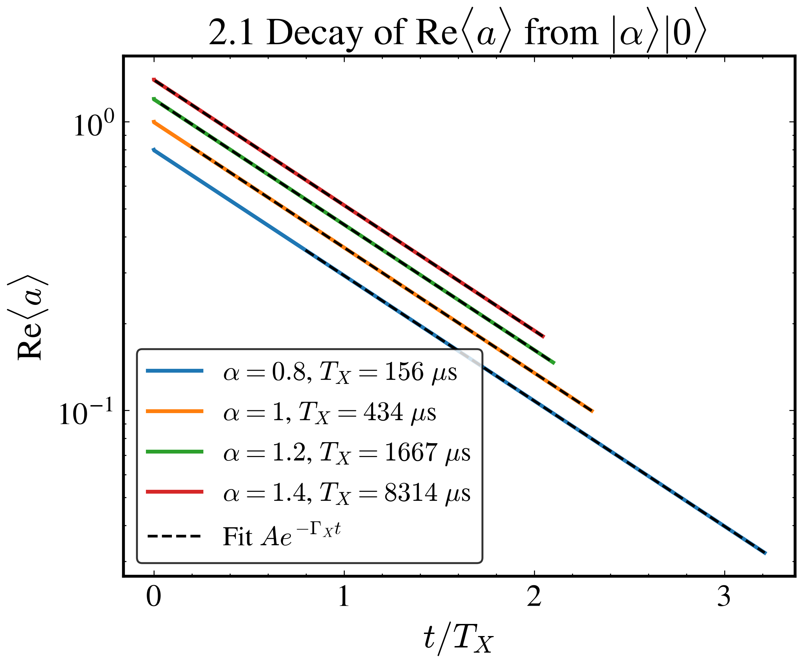

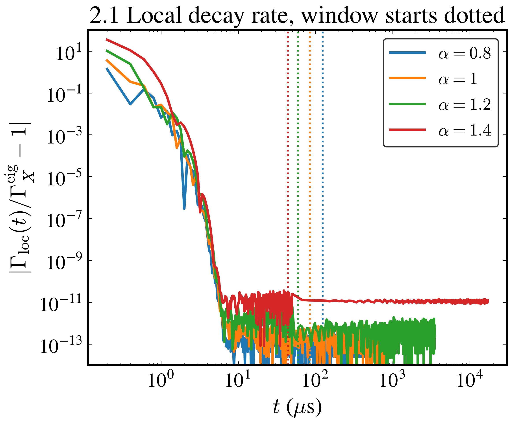

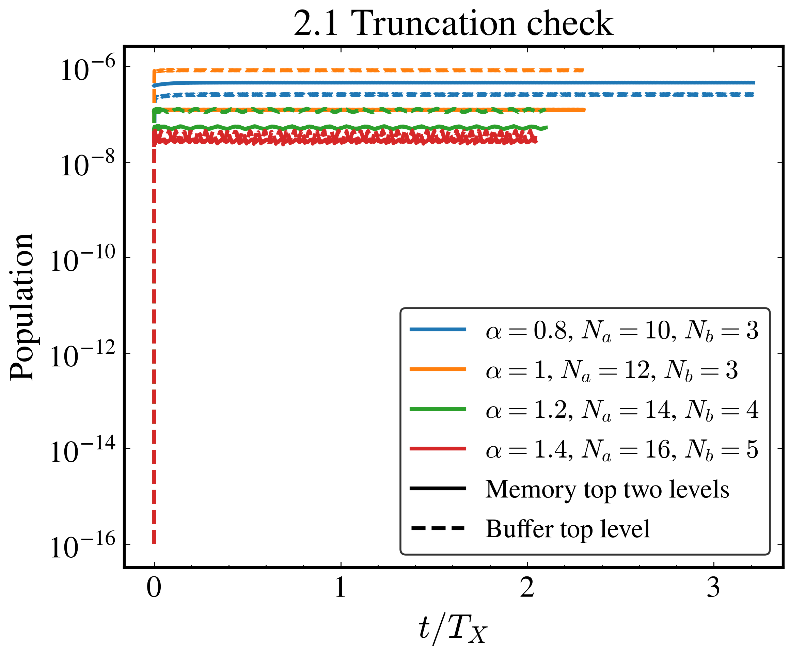

The log-linear fit $\ln\Gamma_X = c - \gamma\alpha^2$ over the four time-domain points gives $\gamma = 3.022 \pm 0.036$ ($n = 4$), and the eigenvalues give the same. This is well above the deck's $\gamma \lesssim 2$, and the two-mode physics below explains the difference.

The naive golden-rule estimate takes a perturbation $V$ between the two wells, $\langle -\alpha|V|\alpha\rangle \propto \langle -\alpha|\alpha\rangle = e^{-2\alpha^2}$, and a rate $\propto |\langle -\alpha|V|\alpha\rangle|^2 \propto e^{-4\alpha^2}$, so $\gamma = 4$. Projecting the loss onto the cat basis makes this concrete. The jump $a$ maps $|\mathcal C_\pm\rangle$ into $|\mathcal C_\mp\rangle$ with amplitudes $\alpha\sqrt{\tanh\alpha^2}$ and $\alpha\sqrt{\coth\alpha^2}$, so the even and odd cats lose photons at slightly different rates, and the symmetric coherence $|\mathcal C_+\rangle\langle\mathcal C_-| + |\mathcal C_-\rangle\langle\mathcal C_+|$, which carries $\mathrm{Re}\langle a\rangle$, decays at

$$\Gamma_X^{(1)} = \kappa_a\alpha^2\left(\coth 2\alpha^2 - 1\right) \approx 2\kappa_a\alpha^2 e^{-4\alpha^2} .$$

Exactly, $\Gamma_X^{(1)} = 2\kappa_a|\langle -|a|+\rangle|^2$ with the orthogonalized wells $|\pm\rangle = (|\mathcal C_+\rangle \pm |\mathcal C_-\rangle)/\sqrt2$ and $\langle -|a|+\rangle = \tfrac{\alpha}{2}\left(\sqrt{\coth\alpha^2} - \sqrt{\tanh\alpha^2}\right) \approx \alpha e^{-2\alpha^2}$, the golden-rule form with the jump operator's matrix element between the wells. The same projection gives $\kappa_a\alpha^2(\coth 2\alpha^2 + 1)$ for the antisymmetric coherence, 0.0811 against $\lambda_2 = 0.0806$ at $\alpha = 0.8$ and 0.2292 against 0.2283 at $\alpha = 1.4$. The exponent of $\Gamma_X^{(1)}$ is 4 only asymptotically: the $\alpha^2$ prefactor lowers the local slope to about $4 - 1/\alpha^2$, and over our four points $\Gamma_X^{(1)}$ alone gives $\gamma = 3.220 \pm 0.073$.

The full model contains this process and one more. Writing $\Gamma_X(\kappa_a) = A\kappa_a + B\kappa_a^2 + \dots$, the part linear in $\kappa_a$ is $2\Gamma_X(\kappa_a) - \Gamma_X(2\kappa_a)/2$, which we get from one more eigenvalue at $2\kappa_a$. It equals $\Gamma_X^{(1)}$ within 0.5% for $0.6 \le \alpha \le 1.4$, as it must, since to first order in $\kappa_a$ only the projection of the loss onto the code space acts; the 0.4% left at $\alpha = 1.4$ is the $\kappa_a^3$ term that the two-point split keeps. The remainder, quadratic in $\kappa_a$, is 2.4% of $\Gamma_X$ at $\alpha = 0.8$ and 25% at $\alpha = 1.4$, and it falls off much more slowly, with a local exponent that rises from 1.31 between $\alpha = 1.0$ and 1.2 to 1.82 between 2.0 and 2.1. It pulls the fitted $\gamma$ from 3.22 down to 3.02. Beyond $\alpha \approx 1.6$ it dominates: $\Gamma_X(2\kappa_a)/\Gamma_X(\kappa_a)$ goes from 2.048 at $\alpha = 0.8$ to 3.626 at $\alpha = 1.8$ and 4.069 at $\alpha = 2.1$, close to the value 4 of a purely quadratic rate (the $2\kappa_a$ eigenvalues at $\alpha = 2.0$ and 2.1 have no larger-truncation check, so the ratio at 2.1 and the remainder exponent between 2.0 and 2.1 are indicative). The local exponent of $\Gamma_X$ therefore peaks at 3.09 near $\alpha^2 = 1.7$ and falls to 1.92 between $\alpha = 2.0$ and 2.1, where $\Gamma_X = 3.849 \times 10^{-7}$ µs$^{-1}$ ($T_X = 2.6$ s, converged in $N_a$ and $N_b$ to $4 \times 10^{-4}$). The deck's $\gamma \lesssim 2$ describes this regime near the operating point, not the small-$\alpha$ range the simulation can reach in the time domain.

The remainder is where the two-mode model differs from the memory-only model of Task 1.0(c). With the same $\kappa_2$, the memory-only $\Gamma_X$ is 11% lower at $\alpha = 1.4$ and 49% lower at $\alpha = 1.8$, and its fit over the four points gives $\gamma = 3.106 \pm 0.056$. The finite buffer bandwidth ($g_2/\kappa_b = 0.29$, $\epsilon_d/\kappa_b$ up to 1.29) strengthens the second-order channel, whose rate falls off slowly with $\alpha$, and only this channel needs the extra buffer levels, since the first-order part lives in the code space.

Thermal photons in the memory bath, with jumps $\sqrt{\kappa_a(1+n_{\mathrm{th}})}\,a$ and $\sqrt{\kappa_a n_{\mathrm{th}}}\,a^\dagger$, lower $\gamma$ already at small $\alpha$: over the same four points $\gamma = 2.749 \pm 0.023$ at $n_{\mathrm{th}} = 0.01$ and $2.019 \pm 0.056$ at $n_{\mathrm{th}} = 0.1$. Either effect, thermal population or larger $\alpha$, brings the exponent down to the deck's value; at $n_{\mathrm{th}} = 0$ and $\alpha \le 1.4$, $\gamma = 3.02$.

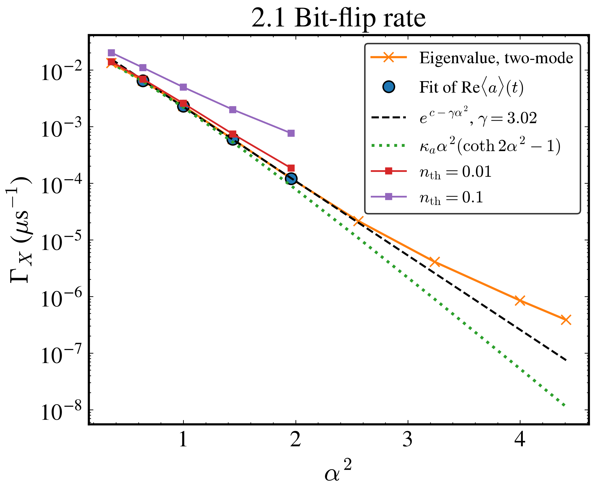

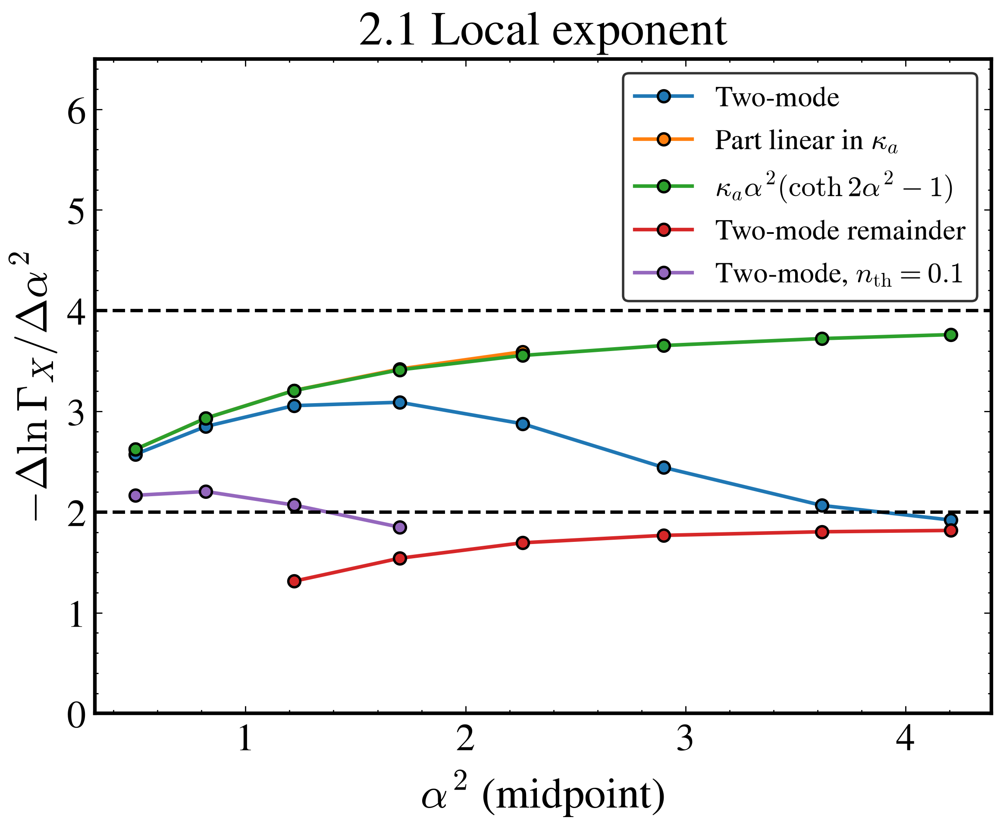

The eigenvalues come from `scripts/task2_1_bit_flip.py eig` and `extra` (Slurm arrays `slurm/task2_1_eig.sh` and `slurm/task2_1_extra.sh`; the largest solves, $28 \times 14$ at $\alpha = 2.0$ and 2.1, took 4442 s and 4530 s), the time-domain runs from `time` (`slurm/task2_1_time.sh`; the longest, $\alpha = 1.4$ at $20 \times 7$ over 8500 µs, took 5540 s in its final job), and `analyze` makes the fits, tables and plots from the caches in under a minute.

## Task 2.2: Extracting the phase-flip rate $\Gamma_Z$

Only $\kappa_a$ breaks the memory parity, and since $Pa = -aP$ the master equation gives exactly $d\langle P\rangle/dt = -2\kappa_a\langle a^\dagger a P\rangle$. In the cat manifold $a|\mathcal C_\pm\rangle = \alpha(\mathcal N_\mp/\mathcal N_\pm)|\mathcal C_\mp\rangle$, so photon loss takes $\mathcal C_+$ to $\mathcal C_-$ at rate $\kappa_a n_e$ and back at rate $\kappa_a n_o$, where $n_e = \alpha^2\tanh\alpha^2$ and $n_o = \alpha^2\coth\alpha^2$ are the photon numbers of the two cats. The parity therefore relaxes as

$$\langle P\rangle(t) = P_\infty + (1 - P_\infty)\,e^{-\Gamma_Z t}, \qquad \Gamma_Z = \kappa_a(n_e + n_o) = 2\kappa_a\alpha^2\coth 2\alpha^2, \qquad P_\infty = \frac{n_o - n_e}{n_o + n_e} = \frac{1}{\cosh 2\alpha^2},$$

which tends to $2\kappa_a\alpha^2$ at large $\alpha$.

We start in $|\mathcal C_+\rangle \otimes |0\rangle$ with $\epsilon_d = \alpha^2 g_2$ in the full two-mode model, with $N_b = 4$ and the $N_a$ of the table. This state is dark for the stabilization, so $\langle b^\dagger b\rangle$ never exceeds $3.0 \times 10^{-5}$. Each run covers three predicted decay times with 601 saved times. We fit $P_\infty$, the amplitude and $\Gamma_Z$ on 0.2 µs $\le t \le T$ ($n$ = 559 to 596 points), which skips the slight initial shrinking of the cat. Fitting from $t = 0$, or only either half of the window, changes $\Gamma_Z$ by at most $3.6 \times 10^{-5}$ (relative). $P_\infty$ stays free, because fixing it at $1/\cosh 2\alpha^2$ shifts $\Gamma_Z$ by 2.0% at $\alpha = 1$.

| $\alpha$ | $N_a$ | $T$ (µs) | $\Gamma_Z$ fit (µs$^{-1}$) | $2\kappa_a\alpha^2$ | $2\kappa_a\alpha^2\coth 2\alpha^2$ | $\kappa_a(n_e + n_o)$ measured | $P_\infty$ fit | $1/\cosh 2\alpha^2$ |
|---|---|---|---|---|---|---|---|---|
| 1 | 16 | 24.7 | 0.12057 | 0.11687 | 0.12123 | 0.12057 | 0.27084 | 0.26580 |
| 1.25 | 16 | 16.4 | 0.18248 | 0.18261 | 0.18331 | 0.18248 | 0.09027 | 0.08770 |
| 1.5 | 16 | 11.4 | 0.26216 | 0.26295 | 0.26302 | 0.26217 | 0.02310 | 0.02222 |
| 1.75 | 20 | 8.4 | 0.35708 | 0.35791 | 0.35791 | 0.35707 | 0.00460 | 0.00437 |
| 2 | 20 | 6.4 | 0.46665 | 0.46747 | 0.46747 | 0.46665 | 0.00071 | 0.00067 |
| 2.1 | 24 | 5.8 | 0.51456 | 0.51538 | 0.51538 | 0.51456 | 0.00032 | 0.00030 |
| 2.5 | 28 | 4.1 | 0.72960 | 0.73042 | 0.73042 | 0.72961 | 0.00001 | 0.00001 |
| 3 | 36 | 2.9 | 1.05098 | 1.05181 | 1.05181 | 1.05099 | 0.00000 | 0.00000 |

At $\alpha = 2.1$ the fit gives $\Gamma_Z = 0.51456$ µs$^{-1}$, a phase-flip time of 1.943 µs, and $\Gamma_Z/2\kappa_a\alpha^2 = 0.99841$. The deficit is the shrinking of the cat by $\kappa_a$. The mean photon number over the window is 4.4026, as in Task 1.2, and $2\kappa_a\langle a^\dagger a\rangle = 0.51452$ µs$^{-1}$. At small $\alpha$ the two parity sectors hold different photon numbers and this shortcut fails (0.10426 µs$^{-1}$ at $\alpha = 1$), so the table uses $n_e$ and $n_o$ measured in each sector at the end of the run. At all eight $\alpha$ they reproduce the fitted rate to $3.2 \times 10^{-5}$ (relative) and the fitted $P_\infty$ to the five printed digits.

As an independent check, Arnoldi iteration on the propagator $e^{\mathcal L\tau}$ ($\tau = 1$ µs) gives the eight slowest eigenvalues of the Liouvillian restricted to operators even under $\rho \to P\rho P$, oscillating ones included, and agrees with dense diagonalization at $\alpha = 2.1$ with $16 \times 4$ levels to $10^{-12}$. The parity eigenvalue matches the fitted $\Gamma_Z$ to $9.1 \times 10^{-6}$ (relative) at every $\alpha$. The next mode is the memory-buffer exchange of Task 1.1, at $-4.73 \pm 20.06i$ µs$^{-1}$ for $\alpha = 2.1$ and $N_b = 8$. It decays 9.2 times faster than the parity there and 4.2 times at $\alpha = 3$, so after a short transient the parity decays as a single exponential. Linearizing about $\pm\alpha$ gives $-\kappa_b/4 \pm i\sqrt{(2g_2\alpha)^2 - \kappa_b^2/16} = -4.08 \pm 19.72i$ µs$^{-1}$, and beyond $\alpha = 1.75$ the decay rate falls toward $\kappa_b/4$ as this linearization improves, to 4.39 µs$^{-1}$ at $\alpha = 3$. A slower real mode at $-3.39$ µs$^{-1}$ in the $\alpha = 3$ base truncation moves with both cutoffs ($-3.85$ at $N_a = 44$, out of the eight slowest at $N_b = 8$), so it is a truncation artifact.

The top two memory levels hold at most $6.5 \times 10^{-7}$ of the population and the top buffer level at most $9.1 \times 10^{-7}$, at every saved time. Rerunning every $\alpha$ at $N_a + 8$ and, separately, at $N_b = 8$ changes $\Gamma_Z$ and the parity eigenvalue by at most $1.4 \times 10^{-5}$ (relative), $P_\infty$ and the photon numbers (sector and window mean) by at most $5.8 \times 10^{-5}$ (absolute), and the exchange mode by at most 0.041 µs$^{-1}$ in decay rate and 0.096 µs$^{-1}$ in frequency.

A linear fit $\Gamma_Z = s\,\alpha^2 + i$ over all eight points gives $s = 0.11656 \pm 2.1 \times 10^{-4}$ µs$^{-1}$, or $0.99738 \times 2\kappa_a$ ($2\kappa_a = 0.11687$ µs$^{-1}$), and $i = 0.00104 \pm 9.7 \times 10^{-4}$ µs$^{-1}$. The coth excess at $\alpha = 1$ ($\coth 2\alpha^2 - 1 = 3.7 \times 10^{-2}$, $\Gamma_Z/2\kappa_a\alpha^2 = 1.03166$) tilts this fit. Over $\alpha \ge 1.5$ ($n = 6$), where the excess is at most $2.5 \times 10^{-4}$, it gives $s = 0.11686 \pm 2.8 \times 10^{-6}$ µs$^{-1}$, or $0.99998 \times 2\kappa_a$, and $i = -0.00080 \pm 1.5 \times 10^{-5}$ µs$^{-1}$, which is $2\kappa_a$ times the 0.0069-photon deficit of the shrunken cat.

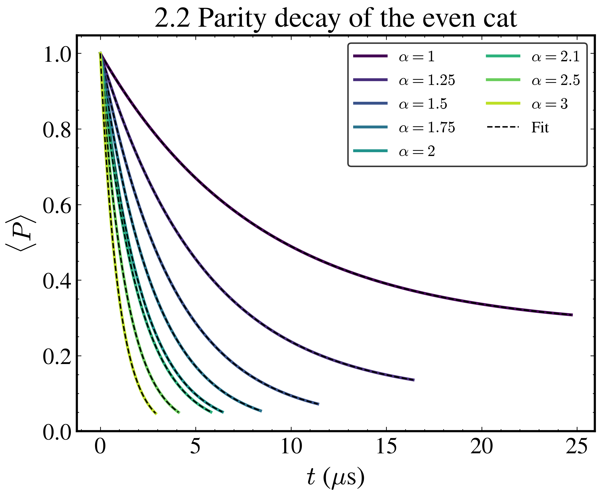

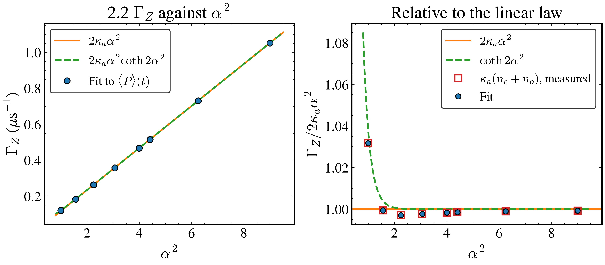

## Task 2.3: Transmon-free memory-bit readout

A resonant drive $\epsilon_Z(a + a^\dagger)$ is added to $H_{2\mathrm{ph}}$ at $\alpha = 2.1$, with the same jump operators. The mean-field equations are

$$\dot a = -i\left(2 g_2 a^* b + \epsilon_Z\right) - \frac{\kappa_a}{2}\,a, \qquad \dot b = -i\left(g_2 a^2 - \epsilon_d\right) - \frac{\kappa_b}{2}\,b .$$

Eliminating the buffer gives $\dot a = -\kappa_2 a^*(a^2 - \alpha^2) - i\epsilon_Z - \kappa_a a/2$, so both wells shift by $\delta a \approx -i\epsilon_Z/(2\kappa_2\alpha^2)$. Setting $\dot a = 0$ with $a \approx \pm\alpha$ gives

$$\langle b\rangle_{\rm ss} \approx \mp\frac{\epsilon_Z}{2\alpha g_2} + i\,\frac{\kappa_a}{4 g_2} .$$

The real part carries the codeword, and the imaginary part, $\kappa_a/4g_2 = 0.003047$, is the buffer field that resupplies, in pairs, the photons lost to $\kappa_a$.

We start from $|{\pm}\alpha\rangle \otimes |0\rangle$ and save 801 times on $0 \le t \le 4$ µs at $N_a = 32$, $N_b = 12$, for $\epsilon_Z/g_2 = 0.05$, 0.1 and 0.2 (main value 0.1, $\epsilon_Z = 0.4794$ rad/µs). After the ringing, $\mathrm{Re}\langle a\rangle$ and $\mathrm{Re}\langle b\rangle$ decay slowly at a common relative rate $\lambda$ while $n_a$ and $\mathrm{Im}\langle b\rangle$ stay flat, which is drive-induced switching between the wells. A linear fit over $3 \le t \le 4$ µs ($n = 201$) gives the $\lambda$ in the table, about 16, 61 and 260 times the undriven $\Gamma_X = 3.85 \times 10^{-7}$ µs$^{-1}$ of Task 2.1, and its $t = 0$ intercept gives the quasi-steady values. The $|{-}\alpha\rangle$ codeword has the opposite real part and the same imaginary part.

| $\epsilon_Z/g_2$ | $\langle b\rangle_{\rm ss}$ from $\lvert{+}\alpha\rangle$ | Re over $-\epsilon_Z/2\alpha g_2$ | Im over $\kappa_a/4g_2$ | Mean field | $\lambda$ (µs$^{-1}$) | 1% homodyne window |
|---|---|---|---|---|---|---|
| 0.05 | $-0.011895 + 0.003115i$ | 0.9992 | 1.022 | $-0.011898 + 0.003075i$ | $6.1 \times 10^{-6}$ | 585.3 µs |
| 0.1 | $-0.023789 + 0.003313i$ | 0.9992 | 1.087 | $-0.023795 + 0.003157i$ | $2.4 \times 10^{-5}$ | 146.3 µs |
| 0.2 | $-0.047572 + 0.004108i$ | 0.9990 | 1.348 | $-0.047589 + 0.003485i$ | $9.9 \times 10^{-5}$ | 36.6 µs |

The real part follows the linear estimate to 0.10%, and at the main drive the contrast $|\langle b\rangle_+ - \langle b\rangle_-|$ is 0.047579 against 0.047619. The imaginary part gains a term of order $\epsilon_Z^2$. The memory shifts 1.3589 to 1.3599 times further than the mean field says; first-order perturbation theory in $\epsilon_Z$ in the displaced frame $a = \alpha + d$, truncated at $24 \times 10$ levels ($16 \times 8$ gives the same response to $3.5 \times 10^{-6}$), gives 1.3598 from the $g_2 d^2 b^\dagger$ term the mean field drops, and leaves $\langle b\rangle$ at exactly $-\epsilon_Z/2\alpha g_2$.

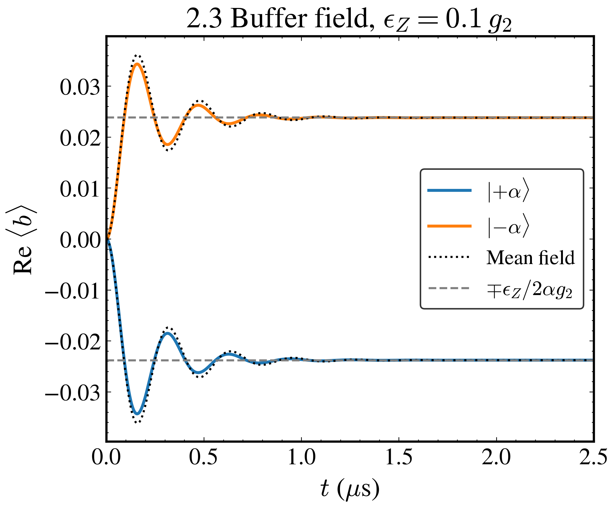

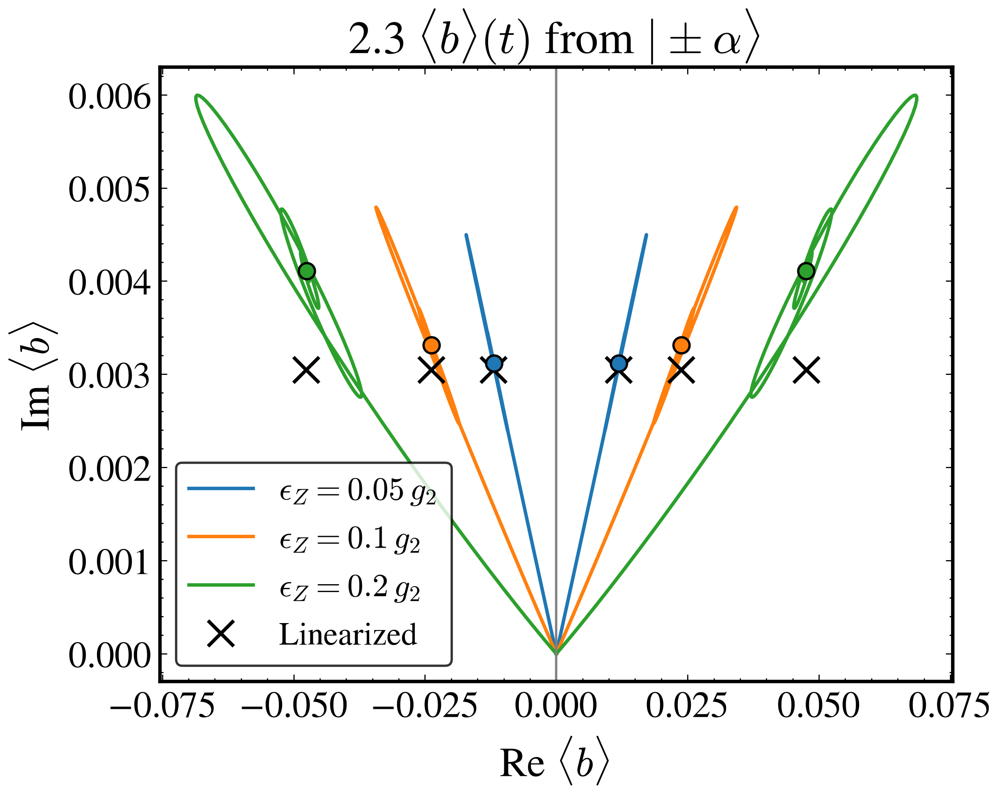

Linearized about the well, the mean field is the oscillator of Task 1.1 driven by a step,

$$\frac{\mathrm{Re}\,\delta b(t)}{\mathrm{Re}\,\delta b_{\rm ss}} = 1 - e^{-\kappa_b t/4}\left(\cos\omega t + \frac{\kappa_b}{4\omega}\sin\omega t\right), \qquad \omega = \sqrt{(2g_2\alpha)^2 - (\kappa_b/4)^2},$$

with period 0.3187 µs, a 52.2% first overshoot and a 1% envelope after 1.133 µs. The drive enters only through $b_{\rm ss}$ and at the main drive moves the decay rates from 4.0841 and 4.1133 µs$^{-1}$ to 3.9836 and 4.2138 µs$^{-1}$. The simulated $\mathrm{Re}\langle b\rangle$ rings too, with a 44.2% first overshoot, crosses its quasi-steady value 6 times before it settles, staying within 1% of the drift line after 0.965 µs, for both codewords and all drives. Divided by $\epsilon_Z$ the three contrast curves coincide. A damped cosine fitted over $0.5 \le t \le 2$ µs ($n = 301$, main drive) gives 4.725 µs$^{-1}$ and 0.3138 µs. This is the dominant pole of the first-order response, $-4.727 \pm 20.078i$ µs$^{-1}$, not $\kappa_b/4 = 4.084$ µs$^{-1}$, and that response tracks the scaled contrast to $3.0 \times 10^{-3}$ where the linearized one is off by 0.081.

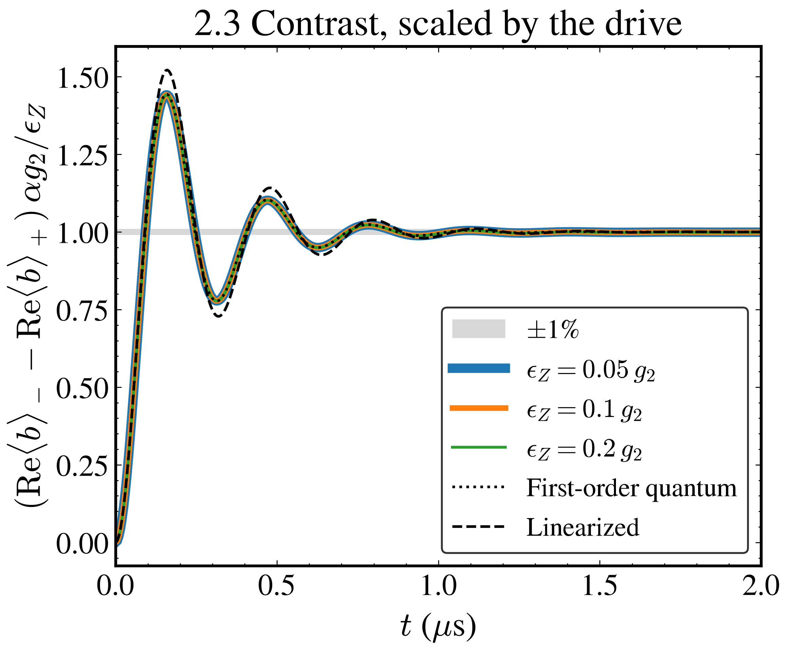

The buffer emits a coherent field $\sqrt{\kappa_b}\,|\mathrm{Re}\langle b\rangle_{\rm ss}| = 0.0962$ µs$^{-1/2}$ at the main drive, a coherent flux of 0.00942 photons per µs. Its population $n_b = 1.087 \times 10^{-3}$ exceeds $|\langle b\rangle_{\rm ss}|^2 = 5.77 \times 10^{-4}$, so it emits $\kappa_b n_b = 0.0178$ photons per µs in all, but the incoherent part shifts the zero-frequency homodyne noise by only $-0.14\%$ to $-0.23\%$ of vacuum noise in a quantum-regression calculation at $24 \times 8$, which $28 \times 10$ reproduces at the main drive ($-0.217\%$). Ideal homodyne detection of the output integrated over $\tau$ misassigns the codeword with probability $\tfrac12\,\mathrm{erfc}\big(\sqrt{2\kappa_b\tau}\,|\mathrm{Re}\langle b\rangle_{\rm ss}|\big)$, which falls to 1% after the windows in the table. The ringing costs nothing, since a matched filter over the 4 µs trace collects 0.007 µs more signal than a field settled from $t = 0$, so a protocol can integrate from switch-on and its window is set by the signal-to-noise ratio, which grows as $\epsilon_Z^2$. Switching grows the same way, and over the 1% window the contrast decays by $\lambda\tau = 3.46 \times 10^{-3}$ to $3.63 \times 10^{-3}$ at every drive, so a faster readout costs a proportionally larger bit-flip rate (Task 2.4).

From a codeword the buffer holds at most 0.0055 photons, far below its peak during the inflation from vacuum (Task 1.1). Every drive was also solved at $16 \times 4$, $24 \times 8$ and $40 \times 16$. Against a tolerance of $10^{-3}$, $24 \times 8$ matches $32 \times 12$ at every drive to a relative $2.0 \times 10^{-7}$ in $\mathrm{Re}\langle b\rangle_{\rm ss}$, $2.0 \times 10^{-4}$ in $\mathrm{Im}\langle b\rangle_{\rm ss}$ and $3.0 \times 10^{-5}$ over the trace, with the same settling time, and $40 \times 16$ matches to $1.6 \times 10^{-8}$, $8.6 \times 10^{-6}$ and $1.8 \times 10^{-6}$. The switching rate converges slowest, with $24 \times 8$ 1.2% to 1.9% high, while $40 \times 16$ matches $32 \times 12$ to $2.3 \times 10^{-4}$ at every drive. $16 \times 4$ fails, with up to $3.0 \times 10^{-4}$ in its top two memory levels, $\mathrm{Im}\langle b\rangle$ up to 22% off and switching at $2.1$ to $2.6 \times 10^{-3}$ µs$^{-1}$. At $32 \times 12$ the top two memory levels hold at most $1.6 \times 10^{-7}$ and the top buffer level $2.5 \times 10^{-8}$, solver noise, since at the main drive the memory value grows with the truncation ($2.3 \times 10^{-8}$ at $24 \times 8$, $2.0 \times 10^{-7}$ at $40 \times 16$).

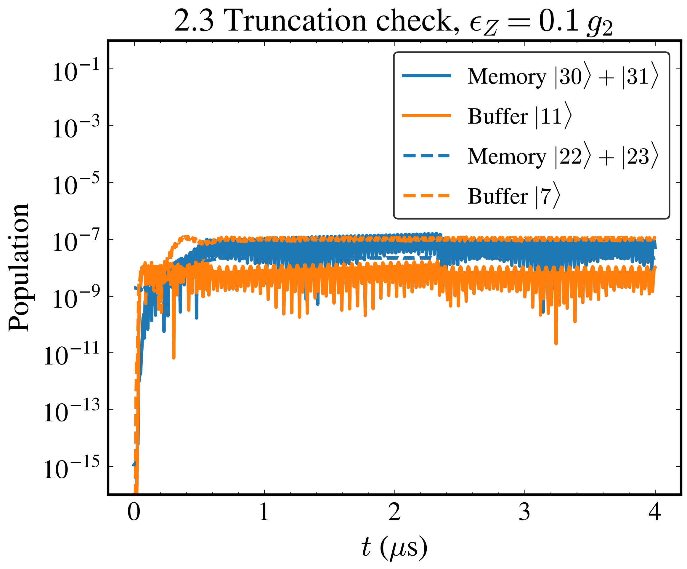

## AI use

Claude Code (Anthropic) wrote the scripts in `scripts/` and `slurm/` and this README. Every number here is printed by those scripts or computed from the stated parameters, and each simulated number is checked against the analytic or semiclassical result beside it. From Task 1.3 on, each task was written by one Claude Code agent and then checked by two independent agents, one re-deriving the physics and one rerunning the headline numbers by a different route and matching every quoted number to the script logs; their findings were fixed before the section went in.
