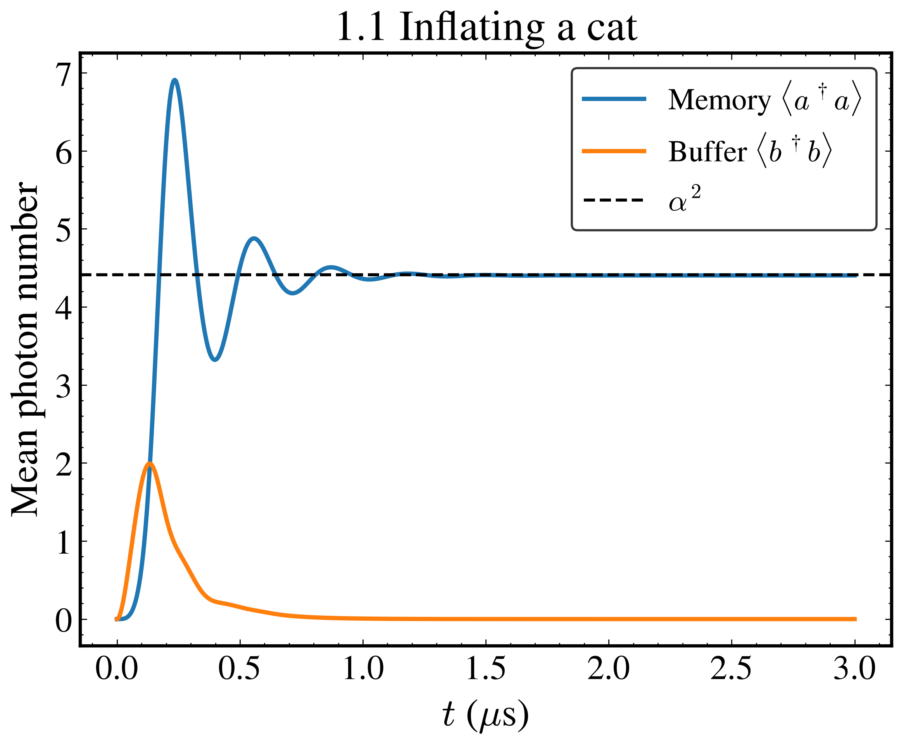
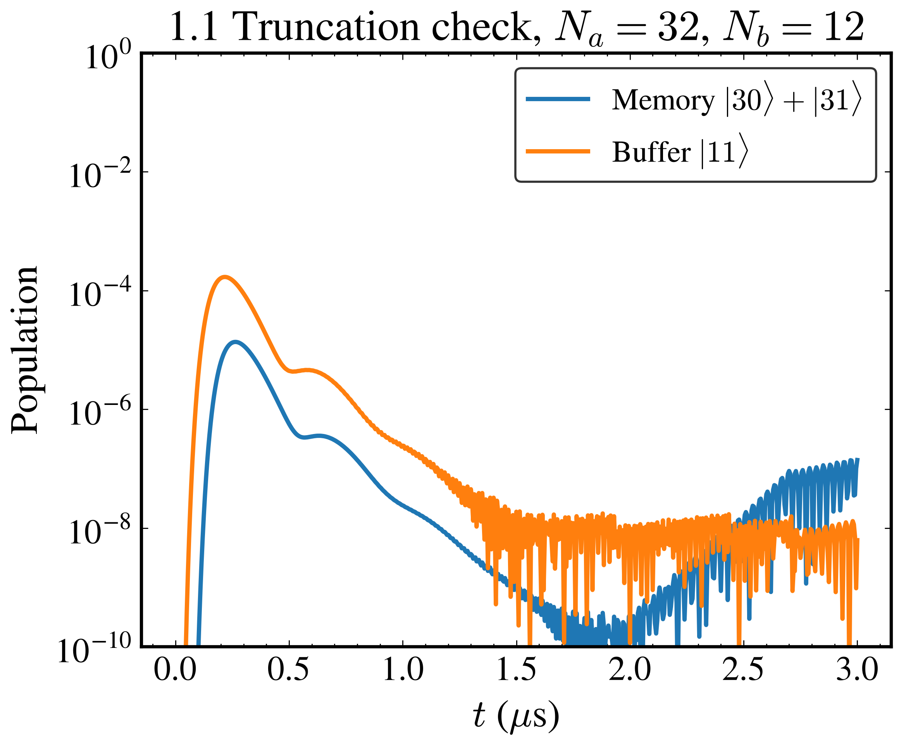
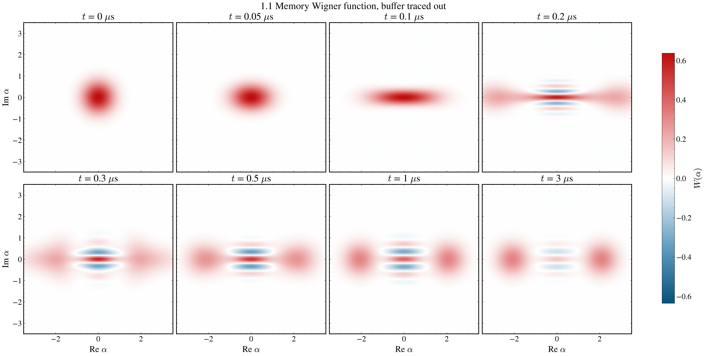
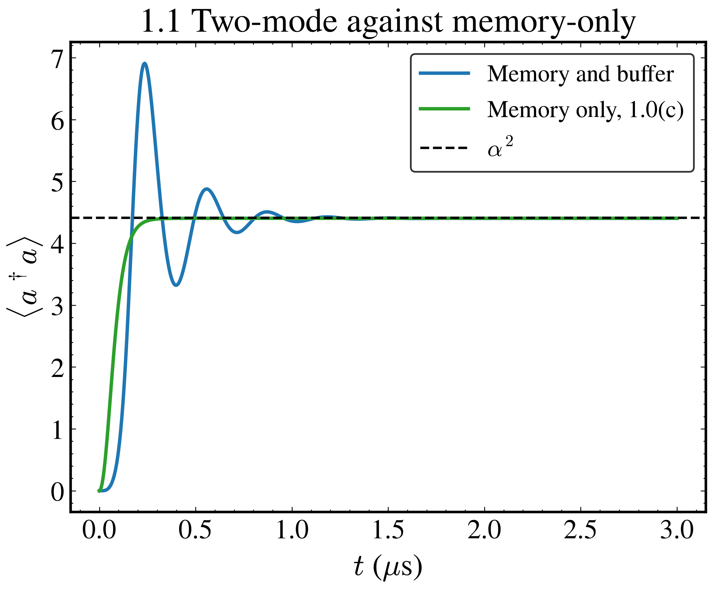
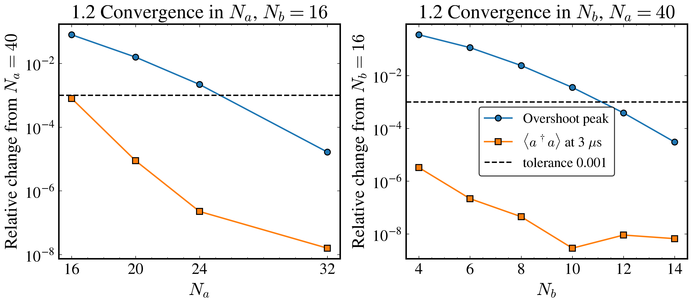
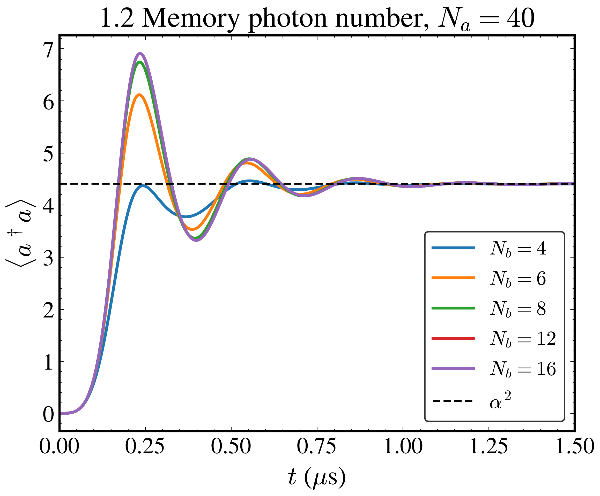
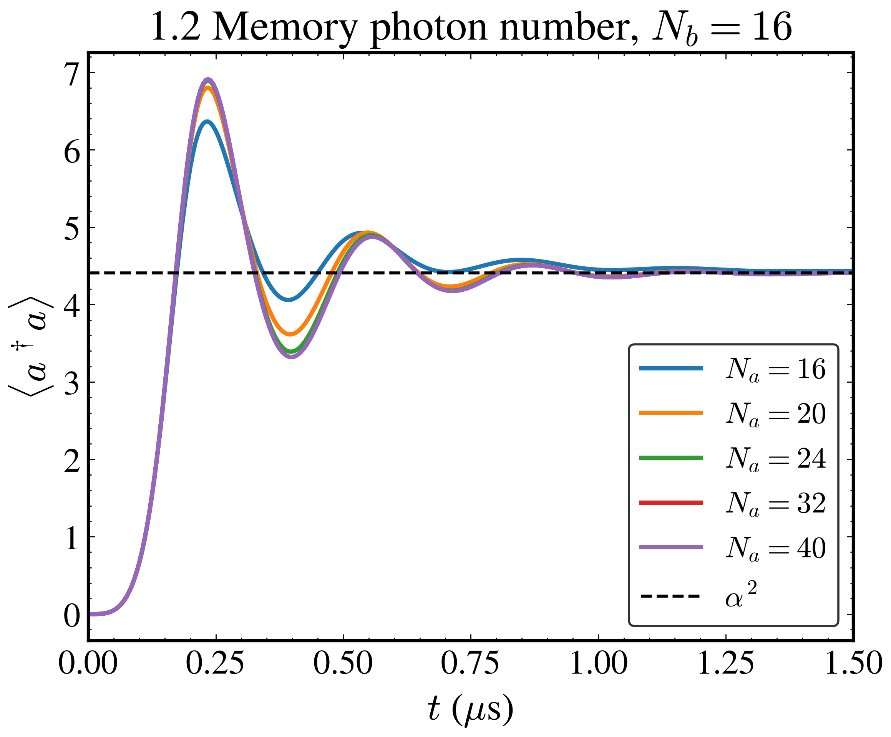

# DuQuantum cat qubit challenge

Simulations for the Alice & Bob cat qubit challenge (`ChallengePrompt.md`), done with `dynamiqs` in double precision. Time is in µs and rates are in rad/µs, with $\omega = 2\pi f$ for every quoted frequency.

Run `uv sync`, then each task script from the repository root, for example `uv run python scripts/task1_0_warmup.py`. Figures go to `plots/` and raw arrays to `results/`. Task 1.0 runs in about 20 s and Task 1.1 in about 50 s on a CPU. Task 1.2 solves 11 two-mode models and took 29 min on one CPU core as a Slurm job (`slurm/task1_2.sh`); finished points are cached in `results/task1_2/`. Shared parameters and plot helpers are in `scripts/common.py`. Every solve uses the adaptive Tsit5 integrator with relative and absolute tolerance $10^{-10}$, because the default $10^{-6}$ left about $10^{-4}$ of noise in small populations.

## Task 1.0: Warm-up — adding dissipation one ingredient at a time

All three parts use one mode truncated at $N = 30$ Fock states. The two-photon rate is $\kappa_2 = 4g_2^2/\kappa_b = 2\pi \times 0.896$ MHz, from $g_2/2\pi = 0.763$ MHz and $\kappa_b/2\pi = 2.6$ MHz. In the Wigner plots a coherent state $|\alpha\rangle$ sits at $(\mathrm{Re}\,\alpha, \mathrm{Im}\,\alpha)$, and the circles in the 1.0(a) figure, drawn at the analytic center, confirm this convention.

### (a) Single-photon loss, in physical units

With $H = \Delta a^\dagger a$ and jump operator $\sqrt{\kappa}\,a$, the mean field obeys $d\langle a\rangle/dt = -(i\Delta + \kappa/2)\langle a\rangle$. Because $a|\alpha\rangle = \alpha|\alpha\rangle$, a lost photon leaves a coherent state unchanged, so the state stays coherent and only its amplitude moves,

$$|\alpha_0\rangle \to |\alpha_0 e^{-(i\Delta + \kappa/2)t}\rangle, \qquad \langle a^\dagger a\rangle = |\alpha_0|^2 e^{-\kappa t}.$$

We take $\Delta/2\pi = \kappa/2\pi = 1$ MHz, $\alpha_0 = 2$ and $0 \le t \le 1$ µs. The simulated photon number matches $|\alpha_0|^2 e^{-\kappa t}$ to $6 \times 10^{-12}$, and the fidelity with the predicted coherent state rounds to 1.00000000 at all 201 saved times. The blob turns clockwise once per µs while it shrinks, and it stays round.

### (b) Pure two-photon loss

With $H = 0$ and jump operator $\sqrt{\kappa_2}\,a^2$, photons leave only in pairs. The jump $a^2$ and the no-jump term $a^{\dagger 2} a^2$ both keep the photon-number parity, so every even Fock state ends in $|0\rangle$ and every odd one in $|1\rangle$, the two states that $a^2$ annihilates. The final photon number is therefore the odd-parity weight of the initial state,

$$\langle a^\dagger a\rangle_\infty = \frac{1 - e^{-2|\alpha_0|^2}}{2} = 0.499832 \quad (\alpha_0 = 2).$$

Only $5e^{-4} = 9\%$ of $|\alpha_0 = 2\rangle$ starts in $|0\rangle$ and $|1\rangle$, yet the plateau is near 0.5, because the whole odd half of the state ends in $|1\rangle$.

The simulation gives $\langle a^\dagger a\rangle = 0.499847$ at 1 µs, $1.5 \times 10^{-5}$ above the analytic plateau. The slowest step, $|2\rangle \to |0\rangle$, has rate $2\kappa_2 = 11.3\ \mu\mathrm{s}^{-1}$, so the curve is flat well before 1 µs.

### (c) Stabilization: two-photon loss + two-photon drive

The jump operator $\sqrt{\kappa_2}\,(a^2 - \alpha^2)$ removes photon pairs and, through the $-\alpha^2$ term, adds them back. Its dark states are $|\pm\alpha\rangle$, since $a^2|\pm\alpha\rangle = \alpha^2|\pm\alpha\rangle$, so the memory settles in the space they span with $\langle a^\dagger a\rangle \approx \alpha^2 = 4.41$ for $\alpha = 2.1$. This jump operator also keeps parity, so the even vacuum goes to the even cat $(|\alpha\rangle + |-\alpha\rangle)/\mathcal N_+$. The second jump operator $\sqrt{\kappa_a}\,a$, with $\kappa_a/2\pi = 9.3$ kHz, flips the parity at each jump and slowly washes out the fringes.

With $\kappa_a = 0$ the master equation is $\dot\rho = \kappa_2 \mathcal D[a^2 - \alpha^2]\rho$, and in the variable $\kappa_2 t$ the rate drops out, so the settling time scales exactly as $1/\kappa_2$. A nonzero $\kappa_a$ adds a second rate and makes this scaling approximate. A mean-field estimate with both terms gives a steady state $\alpha^2 - \kappa_a/2\kappa_2$, slightly below $\alpha^2$.

We start from vacuum, run $0 \le t \le 2$ µs, and solve $\kappa_2/4$, $\kappa_2$ and $4\kappa_2$ in one batched `mesolve` call.

| Rate | $\langle a^\dagger a\rangle$ at 2 µs | Mean field $\alpha^2 - \kappa_a/2\kappa_2$ | Time to stay within 1% | Rate $\times$ time |
|---|---|---|---|---|
| $\kappa_2/4$ | 4.3872 | 4.3892 | 0.990 µs | 1.393 |
| $\kappa_2$ | 4.4040 | 4.4048 | 0.250 µs | 1.407 |
| $4\kappa_2$ | 4.4081 | 4.4087 | 0.065 µs | 1.463 |

Across a factor of 16 in $\kappa_2$ the product of rate and settling time changes by 5%, so the settling time scales as $1/\kappa_2$. The final photon number sits within 0.002 of the mean-field value at all three rates. In the Wigner snapshots at nominal $\kappa_2$ the vacuum blob stretches along $\mathrm{Re}\,\alpha$, splits into two blobs at $\pm 2.1$ with negative fringes between them by 0.1 µs, and the fringes have visibly faded by 2 µs.

## Task 1.1: The full two-mode model — inflating a cat

The full model keeps the buffer mode $b$ next to the memory,

$$H = g_2\left(a^2 b^\dagger + a^{\dagger 2} b\right) - \epsilon_d\left(b + b^\dagger\right), \qquad \epsilon_d = \alpha^2 g_2,$$

with jump operators $\sqrt{\kappa_b}\,b$ and $\sqrt{\kappa_a}\,a$ and vacuum in both modes at $t = 0$. We use $N_a = 32$ and $N_b = 12$, the smallest truncation that converges the overshoot peak to 0.1% in Task 1.2, and run to 3 µs.

The memory photon number overshoots to 6.908 at 0.235 µs, rings, and stays within 1% of $\alpha^2$ after 1.07 µs, so a 2 µs window covers the transient. At 3 µs it is 4.4026. The buffer peaks at 1.992 photons at 0.135 µs and then empties ($1.8 \times 10^{-5}$ photons at 3 µs). In the truncation check the top two memory levels never hold more than $1.4 \times 10^{-5}$ of the population and the top buffer level $1.7 \times 10^{-4}$ (at 0.22 µs). The values near $10^{-7}$ at late times are solver noise, since a 4.4-photon cat puts less than $10^{-14}$ in level 30.

The memory Wigner function, with the buffer traced out, stretches along $\mathrm{Re}\,\alpha$, splits into two blobs at $\pm 2.1$ with negative fringes between them by 0.2 µs, and the fringes are visibly weaker at 3 µs.

The memory-only model of Task 1.0(c) rises smoothly to 4.4042 with no overshoot. That model assumes the buffer empties much faster than everything else, $\kappa_b \gg g_2, \epsilon_d$, but here $g_2/\kappa_b = 0.29$ and $\epsilon_d/\kappa_b = 1.29$. Linearizing the two-mode mean-field equations about the steady state, $a = \alpha + \delta a$ and $b = \delta b$, gives a damped oscillator,

$$\ddot{\delta a} + \frac{\kappa_b}{2}\,\dot{\delta a} + 4 g_2^2 \alpha^2\, \delta a = 0 .$$

Memory and buffer trade photons at $2 g_2 \alpha = 20.1\ \mu\mathrm{s}^{-1}$, faster than the buffer damps the exchange ($\kappa_b/4 = 4.1\ \mu\mathrm{s}^{-1}$), so the memory overshoots and rings with period $2\pi/\sqrt{(2g_2\alpha)^2 - (\kappa_b/4)^2} = 0.319$ µs. The simulated maxima are 0.320, 0.315, 0.315 and 0.310 µs apart. The memory-only model is the overdamped limit $\kappa_b \gg 8 g_2 \alpha$, and here $\kappa_b/8g_2\alpha = 0.20$.

## Task 1.2: Semiclassical sanity check and convergence study

The converged steady state is $\langle a^\dagger a\rangle = 4.4026$, 0.17% below the semiclassical $\alpha^2 = \epsilon_d/g_2 = 4.41$. The difference is physical: it changes by less than $10^{-5}$ (relative) for every $N_a \ge 20$ and every $N_b$ we tried, and single-photon loss is expected to pull the cat in slightly, to $\alpha^2 - \kappa_a/2\kappa_2 = 4.4048$ in the memory-only mean field.

We vary $N_a$ at $N_b = 16$ and $N_b$ at $N_a = 40$ and track two quantities, the steady state at 3 µs and the overshoot peak. A quantity counts as converged at the smallest $N$ from which every larger $N$ agrees with the largest one to $10^{-3}$.

| $N_a$ ($N_b = 16$) | 16 | 20 | 24 | 32 | 40 |
|---|---|---|---|---|---|
| Overshoot peak | 6.3640 | 6.8026 | 6.8960 | 6.9110 | 6.9111 |
| $\langle a^\dagger a\rangle$ at 3 µs | 4.4061 | 4.4027 | 4.4026 | 4.4026 | 4.4026 |

| $N_b$ ($N_a = 40$) | 4 | 6 | 8 | 10 | 12 | 14 | 16 |
|---|---|---|---|---|---|---|---|
| Overshoot peak | 4.4620 | 6.1143 | 6.7442 | 6.8865 | 6.9084 | 6.9109 | 6.9111 |
| $\langle a^\dagger a\rangle$ at 3 µs | 4.4026 | 4.4026 | 4.4026 | 4.4026 | 4.4026 | 4.4026 | 4.4026 |

The steady state converges from $N_a = 16$ and $N_b = 4$, the overshoot peak only from $N_a = 32$ and $N_b = 12$. The two are not equally sensitive. In the steady state the buffer is empty and the memory holds a 4.4-photon cat, so few levels suffice. During the overshoot the buffer briefly holds about 2 photons and the memory 6.9, and both photon-number distributions reach much higher; at $N_b = 6$ the top buffer level holds 4.6% of the population at 0.14 µs. The buffer truncation matters most: the suggested $N_b = 6$ puts the peak 11.5% too low (6.1143 against 6.9111), while the suggested $N_a = 24$ is 0.22% low.

## AI use

Claude Code (Anthropic) wrote the scripts in `scripts/` and `slurm/` and this README. Every number here is printed by those scripts or computed from the stated parameters, and each simulated number is checked against the analytic or semiclassical result beside it.
